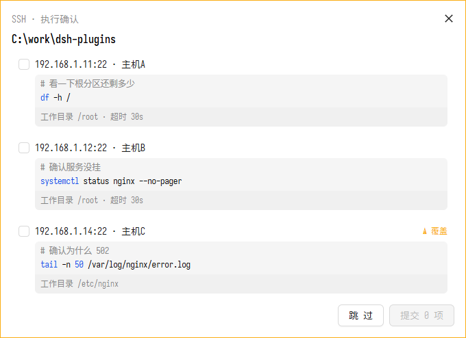
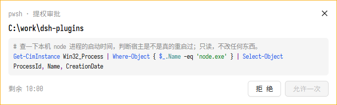

# dsh-plugins

本机 DSH（DeepSeek Harness）插件的统一仓库。**一个插件一个子目录**，每个子目录本身就是一个可安装的 Cordis bundle。

当前插件：

| 子目录 | 作用 | 状态 |
| :--- | :--- | :--- |
| [`dsh-approval-notifier/`](./dsh-approval-notifier/) | 用本机 Windows 原生置顶弹窗承接「提权审批」请求，人不看浏览器也能批准/拒绝 | **已部署（v0.39）并在用**：端到端实测通过（弹窗「拒绝」→ `source:"popup"`、`channel:"file"`）；卡片外壳与偏好由仓库级断言守（`tests/card-shell.ps1` 100 项、`tests/preferences.ps1` 51 项）；关键坑：宿主用 `SW_HIDE` 顶掉窗口第一次 `ShowWindow`，弹窗脚本已显式补偿 |
| [`dsh-approval-allow/`](./dsh-approval-allow/) | 按配置文件的**全串锚定正则**自动同意 `pwsh` / `bash` 审批（含沙箱提权）：全局规则 + 按项目分的规则，改文件热生效，不做卡片交互 | **已部署（v0.39）并在用**；28 项纯 Node 自测全绿（`node --test --test-isolation=none "dsh-approval-allow/tests/allow.test.mjs"`） |
| [`dsh-ssh-remote/`](./dsh-ssh-remote/) | 多主机 SSH 执行与文件搬运：逐条审批、DPAPI 动态凭据、WSL 端点、接入点批量导入 | **已部署（v0.39）并在用**（profile 的 `link:` 指向生产树）：`ssh_status` / `ssh_admin`（只读）/ `ssh_run` / `ssh_copy` 可用，`npm test` 10 个文件 33 项全绿；主机与接入点维护只在插件设置页「SSH 主机」，会话侧没有维护入口（B-47）；设置页主机/资产两表是 CSS Grid 像素列宽（行高 40px），资产列表 `max-height:320px` 内部滚动 + 表头吸顶、整行可点；`ssh_sync` 仍未做 |
| [`dsh-rail-pins/`](./dsh-rail-pins/) | 左侧栏**折叠态**在搜索图标下方显示已 pin 的会话（工作区首字方块 + 官方四态角标 + 悬停详情气泡 + 点击进入） | **已部署（v0.39）并安装**：纯客户端插件，`shell.overlay` 浮层盖住 `_listArea` 等高等宽区域；72 项断言全绿（`node --test --test-isolation=none "dsh-rail-pins/tests/*.test.mjs"`）；Windows 桌面版折叠时整列 `display:none`，只有网页端可见 |

## 卡片长什么样

用卡片的两个插件（`dsh-approval-notifier`、`dsh-ssh-remote`）共用仓库根
[`shared/ui-card/`](./shared/ui-card/) 的一套卡片外壳（WebView2 + React/antd 单文件产物），
结构、样式、交互只有一份。外壳现在只有**两种卡**：勾选卡（`rows`）与审批卡（`body` + 两个按钮）；
`dsh-approval-allow` 不做卡片。下面是 ssh 的勾选卡（三行，其中一行要覆盖目标）：



> **中性示例载荷**：这张图用的是构造出来的**中性示例载荷**（地址 `192.168.1.11/12/14`、备注「主机A/B/C」、
> 工作目录 `C:\work\dsh-plugins`，不是真机资产）**离屏渲染**的，不是真机上弹出来的
> 窗口；按钮发灰是防误点还没解锁。抬头「SSH · 执行确认」是第一行小字（「域 · 动作」两段：左段发起方，
> 右段这张卡要你做什么）；首行是工作目录路径；**一行就是一个执行单位**——勾选框 + 主机一行（第三行右侧
> 橙色 `⚠ 覆盖`），下面一个代码框：`# 原因` 作首行注释、第二行命令、框底附注条放 `工作目录 / 超时`
> （靠深一档底色区分）；行与行之间没有分隔线，只靠留白分块。

另一张是 `dsh-approval-notifier` 的审批卡，内容只有一个只读代码框 + 「拒绝 / 允许一次」两个按钮
（细节见 [审批卡说明](./dsh-approval-notifier/README.md)）：



> **两张截图**（`card-select.png` / `card-approval.png`）已于 2026-11-16 按当前产物 + 中性示例载荷重出，
> `tests/layout.ps1` 第 7 条守「图不比产物旧」。

ssh 的审批**只有这一张卡**（C-10）：根会话、子代理、网页端发起的调用一视同仁，宿主内置的网页提问卡
不再参与，也没有浏览器审批可退——卡片起不来就让命令失败、重试即可。勾选行只写目标，远程主机写成
`地址:端口 · 别名`，同一目标多条时带 `①②③`（B-22 / B-23，见 [ssh README](./dsh-ssh-remote/README.md#卡片长什么样)）。

## 仓库约定

- **一个插件一个子目录**：目录名即包名（`package.json` 的 `name`），子目录内有 `package.json`、`cordis.patch.yml` 与实现文件。完整结构规则见 [`docs/repo-layout.md`](./docs/repo-layout.md)，由 `tests/layout.ps1` 守。
- 插件之间不互相依赖。仓库根只允许 **15 个条目**（白名单见 [`docs/repo-layout.md`](./docs/repo-layout.md) §1，`tests/layout.ps1` 第 1 条守）：本文件，`AGENTS.md`（跨插件规范）、`PREFERENCES.md`（用户偏好硬约束）、`BACKLOG.md`（待办唯一清单）、`THIRD-PARTY-NOTICES.md`（[第三方组件与许可声明](./THIRD-PARTY-NOTICES.md)：随仓库分发的 WebView2 三个 DLL 的 BSD-3 全文，打包进产物的 ssh2 / asn1 / bcrypt-pbkdf）、`.gitignore`，加上四个插件目录与共享物 `docs/`（跨插件结论）、`shared/ui-card/`（用卡片的两个插件共用的外壳与构建产物）、`tools/`（跨插件工具：部署、真窗口预览、审批统计、样例生成）、`tests/`（仓库级断言）、`vendor/`（WebView2 的三个 DLL）。`.agents/`（worktree）与 `.session-files/`（工作区临时区）是本机运行必需但**永不入库**的条目，`out/`、`.dev/` 与根上的 `_*.log` 已禁止出现（旧落点见 `docs/repo-layout.md` §1）。
- [`docs/`](./docs/) 放**跨插件共享的选型与做法结论**，写新插件前先看这里：
  - [`docs/repo-layout.md`](./docs/repo-layout.md)：目录结构与临时物落点（什么能放哪、什么禁止）；
  - [`docs/webview2-card-playbook.md`](./docs/webview2-card-playbook.md)：**做桌面弹窗就看这篇**——接入清单、坑清单、验证命令；
  - [`docs/shared-ui-card.md`](./docs/shared-ui-card.md)：共享卡片外壳的结构与接口（载荷字段、两阶段高度、消息协议）；
  - [`docs/deploy.md`](./docs/deploy.md)：上线、回滚、生产树与打包规则；
- 历史上那两套旧方案（AntdUI 自绘卡、WinForms 控件库调研）的文档已在 `6bfa0e2` 删除，`vendor/antdui/` 也一并移除。
  **要看「当时为什么」就读 [`shared/ui-card/DECISIONS.md`](./shared/ui-card/DECISIONS.md) 与 git 历史**，不要再去仓库里找那两份文件。
- `.session-files/` 是**本仓库自己的跨会话任务状态**，已被 `.gitignore` 忽略，不提交。顶层只允许 `INDEX.md`、`PROJECT_CONTEXT.md`、`TASK_STATE.md`、`tmp/`（调试日志与草稿，可整删）、`build/`（构建副本，可整删）与 `<日期>-<任务名>/` 会话目录；其它条目一律视为垃圾（`tests/layout.ps1` 第 3 条守）。
- **发版三件套**：重出 `docs/images/` 全部卡片截图、核 `BACKLOG.md`、把 `docs/` 里与代码不一致的陈述同步掉。
- **两条出口**：本地这个仓库是唯一真值，完整历史留在这里；对外的 [GitHub 公开仓库 `gjp0609/dsh-plugins`](https://github.com/gjp0609/dsh-plugins) 是**脱敏后的发布快照 + 一条初始提交**，本地历史不外发。
- 提交信息与所有回复使用简体中文。

## 环境（本机固定事实）

| 项 | 值 |
| :--- | :--- |
| DSH 版本 | `@deepseek-ai/dsh` **0.2.2-rc.3**（取自本机 `node_modules\@deepseek-ai\dsh\package.json` 的 `version`）；四个插件都在自己的 `package.json` 里声明了 `engines.dsh: ">=0.2.2-rc.2"`，DSH 版本低于该下限时插件会被拒绝激活，升级后按各插件 README 的兼容性小节核对 |
| 已部署版本 | **v0.39**（tag `31f11b7`），记录在生产树 `production\deploy.json`；上线只走 `tools\deploy.ps1 -Tag <tag>` |
| DSH 安装目录（只读参考，绝不修改） | `C:\work\Scoop\Scoop\persist\nvm\nodejs\v24.9.0\node_modules\@deepseek-ai\dsh` |
| `DSH_HOME` | `%USERPROFILE%\.dsh` |
| profile | `web`（目录 `%USERPROFILE%\.dsh\profiles\web`），本机 GUI 在 `http://127.0.0.1:3080`，浏览器固定用本机 Chrome |
| Shell | PowerShell 7（`pwsh`），Windows PowerShell 5.1（`powershell`）可用 |

## 插件如何装进 DSH profile

本机现状是**手工把四个包写进 profile**：`%USERPROFILE%\.dsh\profiles\web\package.json` 里四条依赖都 `link:` 到
**生产树**，`dsh.profile.bundles` 里追加四个包名；改完在 profile 目录跑一次 `pnpm install` 让链接落地。插件管理器的
`install_bundle` 是同一件事的**等价快捷方式**（省掉手写路径），新装一个包时优先用它。

1. 手工装（改的是工作区外的文件，需一次 `danger-full-access` 批准）：
   - `dependencies` 里四条 `link:`，指向生产树而不是本仓库：

     ```json
     "dsh-approval-allow": "link:C:/Users/me/AppData/Local/dsh-plugins/production/dsh-approval-allow",
     "dsh-approval-notifier": "link:C:/Users/me/AppData/Local/dsh-plugins/production/dsh-approval-notifier",
     "dsh-rail-pins": "link:C:/Users/me/AppData/Local/dsh-plugins/production/dsh-rail-pins",
     "dsh-ssh-remote": "link:C:/Users/me/AppData/Local/dsh-plugins/production/dsh-ssh-remote"
     ```

   - `dsh.profile.bundles` 追加 `dsh-approval-notifier` / `dsh-approval-allow` / `dsh-ssh-remote` / `dsh-rail-pins` 四个包名；
   - 在 profile 目录跑 `pnpm install`，把四个 Junction 建到 `profiles\web\node_modules\`。
2. 或者用插件管理器（改的还是上面那两处，只是路径由它算）：

   ```text
   plugin_manager(action: "install_bundle", target: "C:\work\dsh-plugins\dsh-approval-notifier")
   ```

   `target` 传插件子目录的**绝对路径**；它同样会改 profile 的 `package.json`（加 `link:` 与 bundles 条目），因此也需要一次 `danger-full-access` 批准。
3. 确认生效：读返回值的 `application` / `warnings`，再用 `cordis_inspect_query`（Host `Config.listConfigs`，按包名筛）确认新行处于 live 状态。不要靠日志、进程列表或页面 boot payload 推断。
4. 安装形态：读 `%USERPROFILE%\.dsh\profiles\web\node_modules\<包名>` 的 `LinkType` / `Target`。
   - 软链接（Junction）→ 改**它指向的那棵树**即改已装代码，只需重启 DSH（本机四个插件都是这种）；
   - 拷贝 → 每次改完必须重跑 `install_bundle`。
   - 无论哪种，**替换已装包需要重启才会加载新的 JS 代际**；只改 patch（配置）才能即时生效（profile 为 `patchReload: live`）。
   本机现状：四个插件都 `link:` 到**生产树** `%LOCALAPPDATA%\dsh-plugins\production\`，
   所以**改仓库源码只进测试树**，上线必须走 `tools\deploy.ps1 -Tag <tag>`（见 [`docs/deploy.md`](./docs/deploy.md)）。
5. 卸载/回滚：`plugin_manager(action: "remove_bundle", target: "dsh-approval-notifier")`；手工装的就删掉那两处条目再 `pnpm install`。

## 插件的数据与配置放在哪

插件对**所有会话**生效，而每个会话的工作区不同，所以插件的配置与日志不放工作区、也不进 git，统一放在 DSH 家目录下的一个**公共父目录**里：

```text
%USERPROFILE%\.dsh\plugin-data\
└── approval-notifier\
    ├── config.json      # 用户可改的配置（插件首次运行时自动生成，字段带说明）
    └── logs\            # 运行日志，整个目录可随时删
```

- 这样家目录根上只多出 `plugin-data` **一个**目录，以后本仓库新增的插件都放它下面，不再散落。
- 位置可用插件配置里的 `dataDir` 改到任意路径。
- 目录与默认配置由插件**首次运行时自己创建**，因此除了「安装 bundle」这一步，插件不需要你批准任何工作区外的写入。
- 注意：**工具命令**进程是受限令牌（Low 完整性），只能写「当前工作区 + 本会话私有 temp」，写不了这个数据目录（实测 `Access to the path ... is denied`）；而插件拉起的**弹窗**继承宿主令牌（实测 `High`），写得了。弹窗结果因此做双通道（结果文件 + stdout 标记行，文件优先）——这样即使宿主将来给插件子进程也套上沙箱，决定照样回得来。原因与实测证据见插件 README 的「设计要点」。

