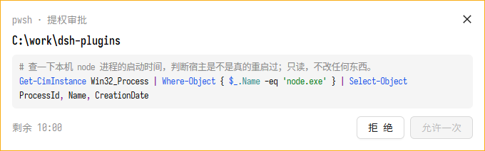

# dsh-approval-notifier

人不在浏览器前时，用**本机置顶卡片**承接 DSH 的**提权审批**请求。卡片用 WebView2 渲染，
界面是仓库根 `shared/ui-card` 的 React + antd 5 单文件产物（和网页端那张卡同一套语言）。

渲染只有这一条路径。卡片起不来（找不到外壳、缺 DLL、没运行时、起窗口失败）时如实报错、退出码 1，
**由宿主退回浏览器审批**——回退能力是宿主既有的，不是这里留的第二套界面。

浏览器卡片照常优先出现；**10 秒**仍没人应答才弹窗；**两侧谁先答谁生效**。



> **这张图是「中性示例载荷」渲染的**：用构造出来的中性示例载荷（工作目录 `C:\work\dsh-plugins`，命令不是真机操作）
> **离屏渲染**，不是真机上弹出来的窗口。图里两个按钮是灰的，因为离屏渲染收不到宿主的 `shown`、防误点还没开始计时；
> 真机上窗口可见 1 秒后解锁，「拒绝」一直可点。
>
> - 抬头是第一行小字「`pwsh` · 提权审批」——「域 · 动作」两段：左段是发起方工具名，右段是这张卡要你做什么；
> - 首行是**工作目录路径**（粗体、字号大一些）：桌面上冒出来的窗口得先让人看出是哪个项目在问。
>   载荷里只有这一条首行字段（路径片段），拿不到路径时整行不出，不退回固定句子；
> - 模型给的理由**不再是框外的一整块正文**，而是命令框的**第一行注释**（灰色、等宽、带 `# ` 前缀）：
>   说明和它说的那条命令待在同一个框里，和设备 ssh 卡同一个形态；同一句说明不会在框外再出现一遍
>   （这张示例图里就是代码框首行的 `# ` 注释）；
> - 一个只读代码框放**完整命令**：等宽、默认换行、除了上面那行说明之外不再写任何模板说明句（B-14）、
>   没有换行按钮，命令一字不改、不加 `$` 前缀；右上角的复制/收起按钮只复制**命令本体**、不含注释；
> - 页脚左边是状态行，图里的 **「剩余 10:00」是这张卡的自动关闭倒计时**：10 分钟无人应答就自己关掉
>   （只关窗、不做任何决定，请求继续等浏览器那张卡）；右边「拒绝 / 允许一次」，右上角 `✕`。

| 场景 | 以前 | 现在 |
| :--- | :--- | :--- |
| 你在本机打游戏/看视频/在 IDE 里干活，模型要写工作区外的文件或联网 | 审批卡只在浏览器页面里，你看不见，模型一直等 | 10 秒后屏幕右下角出现置顶小窗，写着**哪个工作区、什么工具、模型给的理由、真正要执行的命令**；鼠标点一下就把这一步放行或拒绝 |
| 你正在浏览器前 | 照旧在页面上点 | 完全不打扰（10 秒内点了就不会弹窗） |
| 你先在小窗上答了 | —— | 结果立刻生效；浏览器那张卡**不会自动消失**，你回浏览器点一下即可（点了无害），见「已知瑕疵」 |

---

## 前提

- 本机 Windows，交互式桌面（弹窗只在本机可见）。
- `pwsh`（PowerShell 7）或 `powershell`（Windows PowerShell 5.1）。
- **WebView2 运行时**（Edge 自带，Win11 默认就有）：只用于渲染卡片。脚本从注册表
  `EdgeUpdate\Clients\{F3017226-FE2A-4295-8BDF-00C3A9A7E4C5}` 的 `pv` 读版本，本机实测
  `156.0.4314.42`；读不到或起控制器失败就报错退出，请求继续等浏览器。
- **WebView2 SDK 三个 DLL**（约 0.9 MB，**仓库根 `vendor/webview2/` 共享一份**，本插件目录里没有副本）：
  `Microsoft.Web.WebView2.Core.dll`、`Microsoft.Web.WebView2.WinForms.dll`、`WebView2Loader.dll`。
  缺任何一个都报错退出（原因写进 `card-unavailable` 自检行）。
- **共享卡片外壳**（仓库根 `shared/ui-card/`）：`dist/index.html`（React + antd 5 单文件产物，
  **卡片唯一渲染源**）+ `app/src`（它的源码）+ `card-html.ps1`（载荷与文档拼装）+ `webview2.ps1`
  （窗口与消息协议）。本插件只留适配层（`scripts/ui/shared.ps1` + `scripts/ui/card.ps1`），
  不自带副本；找不到外壳时同样报错退出。`dsh-ssh-remote` 用的是同一个外壳，改卡片是两边一起改。
- DSH 的 web profile（本插件挂在 profile 上，对**所有会话**生效，包括你同时在跑的其他会话与子代理）。

## 安装

用 DSH 自带的插件管理器安装（`target` 传本目录的绝对路径）：

```text
plugin_manager(action: "install_bundle", target: "C:\work\dsh-plugins\dsh-approval-notifier")
```

该操作会修改 profile 目录（工作区外），因此需要一次 `danger-full-access` 批准。

装完确认两件事（**不要**靠日志、进程列表或页面数据推断）：

1. 返回值里 `application` 为 `applied`、`warnings` 为空；
2. 查询 Host 的 `Config.listConfigs`（`name` 传 `dsh-approval-notifier`），能看到一行
   `id: "include:approval-notifier"`、`patchId: "approval-notifier"`、`status: "absent"`。
   `absent` 是**正常**的：它表示"本插件没有声明 DSH 的配置表"（原因见「设计要点」），**不代表没装好**。

安装形态：profile 里是一个 **Junction（软链）指回本目录**，所以改这里的文件就等于改已装文件；但**运行中的代码代际不会跟着变**，见下一节。

## 更新（改代码必须重启）

| 你改了什么 | 怎么生效 |
| :--- | :--- |
| `index.js` | **必须重启 DSH**。Node 的 ESM 模块缓存按 URL 命中，DSH 的 HMR 在本 profile 只监听配置（`root: []`），所以改源码不会热重载；插件管理器里关掉再打开也不行（同一个模块 URL）。 |
| `scripts/prompt.ps1`（入口） | **不需要重启**：它是被 `-File` 现读现执行的脚本，下一次弹窗就用新版本。 |
| `scripts/ui/*.ps1`（适配层） | **不需要重启**：同上，入口每次现读。 |
| `shared/ui-card/*.ps1`（共享外壳） | **不需要重启**：下一次弹窗现读；但它是**两个插件共用**的，改之前先确认 `dsh-ssh-remote` 也接受这个改动。 |
| `shared/ui-card/app/src`（卡片源码） | **不需要重启，但必须构建**：改完 `cd shared/ui-card/app; npm run build`，产物写到 `shared/ui-card/dist/index.html`，**把产物一起提交**。不许手改产物，也不许源码与产物不同步。 |
| `shared/ui-card/dist/index.html`（产物） | **不需要重启**：下一次弹窗现读（`New-CardDocument` 每次读它）。 |
| 仓库根 `vendor/webview2/*.dll` | **不需要重启**：每次弹窗现读（`LoadFrom`，不锁文件），换 DLL 下一次就生效。 |
| 配置（`config.json`） | **不需要重启**：下一次审批请求就按新值走。 |
| patch 行配置（`dataDir` / `enabled` / `debug`） | profile 是 `patchReload: live`，改完即时生效（改 `dataDir` 后新日志会写到新位置）。 |

重启会**中断当时正在等待的所有审批**（包括其他会话的），请挑没人等审批的时候重启。

## 卸载

```text
plugin_manager(action: "remove_bundle", target: "dsh-approval-notifier")
```

不会动你的数据目录；想彻底清干净，手动删 `%USERPROFILE%\.dsh\plugin-data\approval-notifier\` 即可。

## 配置

插件首次运行时会在数据目录里生成 `config.json`（**只生成一次，之后绝不改写**）：

```text
%USERPROFILE%\.dsh\plugin-data\approval-notifier\
├── config.json      # 你改这个
└── logs\            # 日志，整个目录可随时删
```

`config.json` 里每个字段都带 `_help` 说明。**存盘即生效**，下一次审批请求就走新值。

| 字段 | 默认 | 含义 |
| :--- | :--- | :--- |
| `delayMs` | `10000` | 浏览器优先的等待毫秒数；超过它没人应答才弹窗。`0` = 立刻弹窗 |
| `armDelayMs` | `1000` | 弹窗出现后按钮保持禁用的毫秒数（防误点） |
| `windowCloseAfterMs` | `600000` | 弹窗自动关闭的毫秒数；**只关窗，不做任何决定**。`0` = 永不自动关闭 |
| `renotifyMs` | `0` | 窗口自行关闭后，再过多少毫秒重新弹一次。`0` = 不再提醒 |
| `sound` | `true` | 是否播放提示音 |
| `shell` | `"pwsh"` | 拉起弹窗的可执行文件；可改 `"powershell"`（5.1） |

**优先级**：`config.json`（你平时改的）**高于** profile 的 `cordis.patch.yml` 里那一行。
`dataDir` / `enabled` / `debug` **只能在 patch 行里改**（改它们要重启，且 `dataDir` 若也能被文件改写会变成自指）：

```yaml
- insert:
    - id: approval-notifier
      name: dsh-approval-notifier
      config: { dataDir: null, enabled: true, debug: false }
```

值写错（类型不对、JSON 语法坏了）不会被当成故障：非法键回落默认、坏文件整份忽略，只记一条 `config-notes` 日志，**绝不会因此崩掉或静默放行**。

## 行为约定

| 项 | 行为 |
| :--- | :--- |
| 通道 | 本机置顶卡片（**WebView2**，由仓库根 `shared/ui-card/` 的共享外壳渲染；**这是唯一的渲染路径**，外壳缺失 / 缺 DLL / 起不来就写 error 结果并退出码 1，由宿主退回浏览器审批），固定出现在**主屏工作区右下角**（右边距/下边距 16px） |
| 多窗错开 | 只在**同时还有别的弹窗开着**时才向上错开（整卡一层 + 8px 间隙，地方不够就压缩，但至少留出底部按钮条，保证每个窗口都点得到）；窗口一关就归还，所以下一次审批仍然回到右下角。在场次序由弹窗自己量（数据目录 tmp 下的登记文件），宿主计数只作兜底 |
| 外观 | **680 宽、内容自适应高**的**方形**卡片（圆角 0；两个插件共用同一套 antd 5 视觉与字体）：抬头是第一行小字「工具名 · 提权审批」、首行是工作目录路径（粗体、字号大一些）；中间一个只读命令代码框（等宽字体、默认换行、**Shiki 代码高亮**），模型给的理由就是**框内第一行注释**（灰色 `# …`），框外不再单独摆一块正文；右上角是悬停才出现的复制/收起按钮；页脚左边是状态行，右边「拒绝 / 允许一次」，右上角 `✕`。无系统标题栏；卡片**不可拖动**（外壳没有 app-region 拖动区）；窗口尺寸与落位按系统 DPI 换算 |
| 字体 | 整张卡统一 **等距更纱黑体 SC**（英文名 Sarasa Mono SC）。字体只在 `shared/ui-card/app/src/main.tsx`（antd 的 `fontFamily` / `fontFamilyCode`）与 `app/src/styles.css` 的 `body` 栈里各设一次，不逐元素写 `font-family`；实际落笔的字体由 `tests/card-font.ps1` 问渲染引擎核对，不靠看 |
| 高度 | 屏高的 62%，夹在 160–760px 之间；内容超了只在**卡片中部**滚动（WebView2 原生细滚动条），页脚始终钉住。不翻页、不折叠 |
| 键盘 | **卡片不响应任何键**：适配层给外壳传了 `-Keyboard none`。外壳默认会把 `Enter` 绑到主按钮，而这里的主按钮是「允许一次」——回车误批一次提权，比少一个快捷键严重得多；`Esc` 一并禁掉，免得「有时能关、有时不能」变成新的困惑。浏览器快捷键（F5/F12/Ctrl+W 等）本来就不受影响 |
| 防误点 | 窗口**真的出现在屏幕上之后**才开始 `armDelayMs`（默认 1 秒）倒计时，期间两个按钮置灰不可点（页面不额外写倒计时文案，只有按钮置灰；`closeAfterMs` > 0 时页脚会显示「剩余 m:ss」） |
| 焦点 | **显示时不抢焦点**（共享外壳用 `ShowWindow(SW_SHOWNOACTIVATE)` + `SetWindowPos`，不打断你在游戏/编辑器里的键盘输入）；窗口是普通置顶窗，点它会激活窗口。旧文档写的 `WS_EX_NOACTIVATE` 在旧卡与外壳里都从未设置过，这里按代码改正 |
| 提醒 | 置顶 + 任务栏闪烁 +（默认）提示音 |
| 谁先答谁生效 | 浏览器先答 → 立刻关掉弹窗、采用浏览器结果；弹窗先答 → 采用弹窗结果，把结果交给下游 |
| 点 X / 到点自动关 | **不回答**：不说允许也不说拒绝，请求继续等浏览器 |
| 超时 | **永不自动接受、也永不自动拒绝**。两边都没人答 → 模型一直等（这是明确选择：避免"被拒绝后模型绕远路"） |
| 请求被取消 / 插件被卸载 | 立即终止弹窗进程，不留孤儿窗口（残留的在场登记由下一个弹窗按"进程已死"清掉） |
| 弹窗显示 | 抬头是「工具名 · 提权审批」（工具名取自载荷的窗口标题，无需宿主改动）；首行是**工作目录**（判断命令"在哪儿跑"的主要依据；路径原样展示，插件与外壳都不截断）；模型给的理由会**去掉宿主那句固定前缀**（`允许本次操作使用 … 权限：` 每个请求都一样，没有信息量），然后作为**命令框内第一行注释**（`# …`）展示——说明和它说的那条命令待在同一个框里，框外不再重复；理由内部的换行折成一个空格（注释只有一行，多出来的未加 `#` 的行会被读成「还要执行的命令」），措辞不改、长度不截断；命令代码块显示**完整命令**——命令 / 路径 / 参数原文**一个字都不截**（只有拿不到参数摘要的工具才退回显示 JSON，且超过 6000 字符时截断处显式标注「…（已截断）」）。首行只用路径，不用固定句子（B-16），也不写「判断以此为准」这类说明句（B-14）。理由与命令都是**模型生成的原文**，判断请以命令本身为准 |
| 判断依据 | 理由和参数都是**模型生成的原文**；理由可以参考，**判断请以命令本身为准** |

## 日志与排障

默认日志：`%USERPROFILE%\.dsh\plugin-data\approval-notifier\logs\notifier.log`（每行一条 JSON）。
（阶段 1 的零干扰探针日志是同一个目录下的 `probe.log`，与它并列保留。）

关心的 `phase`：

| phase | 含义 |
| :--- | :--- |
| `plugin/activated` | 插件已激活（与原配置一起记录） |
| `approval/request/enter` | 收到审批（含 `toolName` / `callId` / `argumentsFound`；**不记录命令内容**） |
| `approval/request/next-settled` | 请求结算，`source` = `downstream`（浏览器/下游先答）/ `popup`（弹窗先答）/ `aborted`（被取消），带 `elapsedMs` |
| `popup-spawned` / `popup-decision` / `popup-no-decision` | 弹窗拉起、给出决定（`channel` = `file` / `stdout`）、没给决定（含 `resultKind`、`resultChannel`、退出码、`stderr` 片段） |
| `popup-spawn-failed` / `popup-abandoned` | 弹窗起不来（此时自动回落到"只等浏览器"） |
| `orchestration-failed` | 插件自身编排出错（已把决定权交回下游，绝不静默放行） |
| `config-notes` | `config.json` 里有非法值/坏 JSON，已回落默认 |

常见症状：

| 症状 | 先看什么 |
| :--- | :--- |
| 完全不弹窗 | 浏览器是否在 `delayMs` 内答了（`next-settled` 的 `source`）；`delayMs` 是否被改大；有没有 `enter` 行 |
| 有 `enter` / `popup-spawned` 但**看不到窗口** | 弹窗自检（见下）里的 `visibleBefore` / `visibleAfter`；两个都是 `false` 说明显式 show 都没生效（多半是独占全屏或窗口站异常） |
| 窗口点了按钮，模型却没按你的选择走 | `popup-decision` 的 `channel` 是否存在；只有 `popup-no-decision` 说明决定没送回来，看它的 `resultChannel` 与 `stderr` 里的自检 |
| 有 `enter` 但没有窗口 | `popup-spawn-failed` / `popup-no-decision` 里的 `stderr`；`shell` 是否写错 |
| 按钮点不动 | 前 1 秒是**设计如此**；一直点不动就看 `armDelayMs` |
| 弹窗答了但模型行为不对 | 看 `next-settled` 的 `source` 与 `outcome`；若 `source: downstream`，说明浏览器那边先答了 |
| 改配置没生效 | 文件是否保存成功、键名是否拼对；非法值会被忽略并记 `config-notes` |
| 日志不增长 | patch 行的 `debug: true` 看宿主控制台；确认 `dataDir` 是否为 `null`（默认位置） |
| 独占全屏游戏里看不见 | 已知限制：独占全屏会盖住一切窗口，那时只有提示音与任务栏闪烁；**无边框窗口化**（多数游戏默认）正常 |

## 弹窗自检（`DSH-APPROVAL-DIAG`）

弹窗进程每次启动都会给自己量一次环境，写成一行 `DSH-APPROVAL-DIAG {…}`，三个落点能写哪个写哪个：

1. **stderr** —— 宿主在"没有决定"时会把它记进 `popup-no-decision` 的 `stderr` 字段（这条通道不依赖任何文件权限）；
2. `<结果文件>.diag`（同目录；插件拉起的弹窗有写权限，本机实测能落盘）；
3. 本会话私有 temp 下的 `dsh-approval-notifier-diag.jsonl`（受限进程下这条更可靠）。

关心这些字段：

| 字段 | 含义 |
| :--- | :--- |
| `renderer` | 这次用的渲染通道，恒为 `card`（WebView2）。字段保留是为了让旧日志还读得懂；它出现在 `shown` / `outcome` 两类记录里 |
| `visibleBefore` / `visibleAfter` | 窗口的**真实** WS_VISIBLE 位（`IsWindowVisible`）。前者是 `false` 就说明第一次显示被宿主的 `SW_HIDE` 顶掉了，后者是显式再 show 之后的结果 |
| `integrity` | 进程完整性级别。插件拉起的弹窗**继承宿主令牌**（本机实测 `High`，因此能写数据目录）；同一份自检在**工具命令**里跑会显示 `Low`（受限令牌，只能写授权根目录） |
| `sessionId` / `userInteractive` | 是否在交互式桌面里（`0` 或 `false` = 窗口不会出现在你面前） |
| `tempDir` / `resultDirWritable` / `tempWritable` | 各目录**真写一次文件**试出来的可写性（不是猜的） |
| `windowBounds` | 窗口实际位置与尺寸（判断是否跑到屏幕外）。右下角 = 主屏工作区右边/下边各留 16px |
| `slotRank` / `slotCount` / `slotSource` | 这次弹窗认为自己是**同时在场**的第几个、当时一共几个；`slotSource` = `claim`（弹窗自己量的登记文件，正常路径）/ `payload`（登记写不出去，回落到宿主计数） |

另外两类阶段记录（只在需要时出现）：

| 阶段 | 含义 |
| :--- | :--- |
| `card-rendered` | 卡片量完尺寸并显示出来了，带 `contentWidth` / `contentHeight`（CSS px） |
| `card-unavailable` / `card-failed` / `card-shell-missing` | 卡片没起来，`reason` 写明原因（缺哪个 DLL / 运行时版本 / 找不到外壳 / 起窗口的异常）。**这是本次审批退回浏览器审批的唯一现场**。`card-failed` 另带 `stack`（异常调用栈，截断 4000 字符），用来直接看崩在哪一行 |

## 本地自测（不需要 DSH、不需要重启）

编排逻辑（浏览器优先、谁先答谁生效、取消即关窗、点 X 继续等、卸载不留孤儿、配置文件优先级与非法值回落……）用**假的 ctx / 假 subprocess 驱动真实的 `index.js`**，全部由桩测试覆盖：

```powershell
node dsh-approval-notifier\tests\orchestration.test.mjs
```

60 项断言（含结果通道、stdout 噪声与半行、弹窗起不来时回落浏览器、"插件与脚本的结果标记必须一致 / 显示窗口只在共享外壳里 / 入口不再引用原生卡"这几条源码契约、"依次审批时 slot 恒为 0 / 同时在场的两个弹窗错开"，以及"1200 字符多行命令的长度与原文一致、末尾没有省略号 / 兜底 JSON 超长时带「已截断」标注 / 6000 上限只作用于兜底 JSON"这三条截断回归）；输出 `结果：全部通过` 即通过（临时目录放在系统临时区，不污染仓库，也不接触你真实的配置与日志）。
**改完 `index.js` 先跑它，再重启 DSH 做真机验证**，可以少走一轮重启。

卡片适配层（**不弹窗**，只拼 HTML / 校验映射 / 用假窗口验端到端，几十毫秒跑完）：

```powershell
pwsh -NoProfile -File dsh-approval-notifier\tests\card-select.ps1
```

34 项断言：外壳在不在（从插件上溯找到仓库根 `shared/ui-card`）、缺外壳时是否抛明确错误、
**插件里没有外壳副本与 DLL 副本**、dot-source 之后外壳同名函数没被插件覆盖、
**源码契约（产品代码里连 AntdUI 的目录与引用都没有；README 可以点名「已删除」，那属文档职责、不算引用；`-Renderer` 只剩 `auto` / `card`）**；
开头取工具名与工作目录、没有工作目录时回退、`< & "` 转义、
**说明句进命令框（理由在 `body[].comment` 里、框外不再有同一句、不自己加 `# ` 前缀、超长不截断、
换行折成一行、没有说明时载荷里连 `comment` 键都没有（不是空字符串）、没有命令就退回正文块、
说明由 `New-CardCodeBlock -Comment` 直出且适配层没有补丁函数）**、
两个按钮的语义与配色、防误点/自动关闭的毫秒数进载荷、方形与宽度/限高同源、
决定映射（`allowed-once` / `rejected` / `cancel` / 超时 / 出图 / 认不出来一律不算答）、
返回对象字段恒定、以及**假窗口端到端**（决定 / 取消 / 到点 / 起不来 / `-RenderTo` 五条分支）。
输出 `全部通过` 即通过。

决定路径的「标量」自检（**不弹窗**，守 2026-11-02 那个「点按钮就崩」的缺陷，见 DECISIONS D-04）：

```powershell
pwsh -NoProfile -File dsh-approval-notifier\tests\decision-scalar.ps1
```

11 项断言：外壳返回数组（`OnShown` 输出泄漏的形态）时 `Invoke-CardApproval` 不炸、决定类型正确、
**返回对象只有一个**、`contentWidth` / `contentHeight` 是 `[int]`、`windowBounds` 是 `[string]`；
单对象路径、`failed`、`cancel` / 到点四条不被新的取值方式吃掉、外壳没吐结果对象时抛明确错误
（不静默当「没决定」）；以及源码契约三条
（外壳接住 `OnShown` / `OnRendered` 的返回值、插件回调接住 `Invoke-TaskbarFlash`、
`$window` 从 `$outputs` 里按 `Action` 认出来）+ `card-failed` 诊断带截断后的 `stack`。
输出 `全部通过` 即通过。

仓库级还有两条纯逻辑测试（外壳本身与「只有一份」的守卫，改动外壳或接入方式后都该跑）：

```powershell
pwsh -NoProfile -File tests\card-shell.ps1
pwsh -NoProfile -File tests\shared-ui-guard.ps1
```

真机弹窗可见性（会在你的屏幕上弹一下，最长 `-CloseAfterMs` 毫秒，自己会关、不做任何决定）：

```powershell
& dsh-approval-notifier\tests\popup-visibility.ps1 -CloseAfterMs 4000
# 量多窗错开（埋一个"另一个弹窗还在场"的登记，窗口应高出一整卡）：
& dsh-approval-notifier\tests\popup-visibility.ps1 -CloseAfterMs 4000 -SimulateSibling
# 抓一张"屏幕上真实长什么样"（IsWindowVisible 证明不了内容画上去了）：
& dsh-approval-notifier\tests\popup-visibility.ps1 -CloseAfterMs 4000 -ScreenShot card.png
```

要在**宿主 spawn 出来的进程里**跑（例如在 DSH 里把上面整条当命令执行），它才继承与真实弹窗相同的启动条件（含 `SW_HIDE`）；输出 `visibleAfter=true` 且退出码 0 即通过（`-Renderer card` 时还会核对 `rendererUsed` 是否真的是 `card`，防止"通过"是假的——`auto` 与 `card` 现在等价，只有一条渲染路径）。脚本刻意**不做**嵌套 `Start-Process`：那既不继承该条件，在受限 shell 里还会直接以 `0xC0000142`（STATUS_DLL_INIT_FAILED）失败。

点击也要验一次（`AGENTS.md` 第 4 条：弹窗必须真弹一次并点一遍）。这个脚本会往屏幕上注入**真实鼠标输入**（`SetCursorPos` 之后必须补一次绝对坐标 `MOUSEEVENTF_MOVE`，只挪光标 Chromium 会拿旧位置命中，点哪哪不灵）：

```powershell
& dsh-approval-notifier\tests\card-click.ps1 -Target allow   # 期望 allowed-once
& dsh-approval-notifier\tests\card-click.ps1 -Target deny    # 期望 rejected
& dsh-approval-notifier\tests\card-click.ps1 -Target close   # 期望 closed
```

它点之前会回读光标，偏差超过 4px 就重试三次、仍不中就放弃点击并说明原因（人手正握着鼠标时不会瞎点）。坐标是按窗口矩形算的，**卡片布局改了这里也要跟着改**；点空本身就是"按钮不在你以为的地方"的信号。

字体（离屏起一个 WebView2，问渲染引擎**实际落笔**的是哪款字体；CSS 栈写了什么不算数）：

```powershell
& dsh-approval-notifier\tests\card-font.ps1
```

10 项断言：本机装没装「等距更纱黑体 SC」、它是不是等宽（窄字宽字同宽）、正文与代码的栈第一项是不是它、
首行（路径）/理由/命令三处 `CSS.getPlatformFontsForNode` 报的族名是不是它、有没有回退到 Segoe UI / 微软雅黑 / Consolas。
注意 Chromium 报的是**英文族名** `Sarasa Mono SC`——同一个字体，断言要认两个名字。
自己让机器点只是回归用；验收时仍以**人手点一次**为准。

**只看外观时别弹窗**：`prompt.ps1` 带一个只给自检用的开关，渲染成 PNG 就退出（按"未做决定"收尾）：

```powershell
& dsh-approval-notifier\scripts\prompt.ps1 -PayloadFile <自己造的 payload.json> -OutFile <临时 out.json> -RenderTo card.png
```

`-RenderTo` 走共享外壳：没有「挪到屏幕外」这个模式，窗口会在右下角**闪一下**再关（而且要提权跑，
受限令牌下 WebView2 起不来）。`-ScreenShot` 抓真实屏幕（`BitBlt` + `CAPTUREBLT`，
`CopyFromScreen` 会漏掉置顶窗口、截出一张白卡）。两种 PNG 都只能证明长相；**截真屏**和
**人手点一次**都不能省。

## 弹窗长什么样

| 窗口 | 用在哪 | 技术 |
| :--- | :--- | :--- |
| 本机卡片 | 提权审批（唯一通道） | **WebView2** + React/antd 单文件产物 |

### 本机卡片

结构照抄网页端那张卡：抬头「工具名 · 提权审批」、首行是工作目录（路径）、中间一个只读代码框放完整命令——
模型给的理由是**框内第一行注释**（`# …`，与设备 ssh 卡同一个形态），框外不再单独摆一块正文；
命令原样展示，**不加 `$` 前缀**、不写别的说明行；页脚左边状态行、右边「拒绝 / 允许一次」、右上角 `✕`。
长相与逐项说明见文首那张图（图是改版前渲染的，理由还在框外）。

样式只有一个来源（**仓库根**，与 `dsh-ssh-remote` 共用），不要另写一份、也不要在插件目录里留副本
（由仓库根 `tests/shared-ui-guard.ps1` 断言）：

| 文件 | 是什么 | 改法 |
| :--- | :--- | :--- |
| `shared/ui-card/app/src/App.tsx` | 卡片结构、交互（防误点、倒计时、键盘、✕、勾选行） | 改外观/交互改这里 |
| `shared/ui-card/app/src/main.tsx` | 挂载与 antd token（**字体**、字号、圆角、控件高） | 改字体/视觉基线改这里 |
| `shared/ui-card/app/src/styles.css` | antd 表达不了的三件事：两阶段高度契约、细滚动条、去焦点环 | 只能在这里补 CSS |
| `shared/ui-card/dist/index.html` | 上面三者的构建产物（约 711 KB / 728,537 字节，入库） | **不许手改**；`npm run build` 生成 |
| `shared/ui-card/card-html.ps1` / `webview2.ps1` / `webview2-runtime.ps1` | 外壳的拼装层、窗口层、运行环境层 | 通用能力改这里，改完两个插件一起验 |

**改卡片外观的唯一流程**：改 `app/src` → `cd shared/ui-card/app; npm run build` → 把
`dist/index.html` 一起提交 → 跑 `tests/card-shell.ps1` 与 `tests/shared-ui-guard.ps1`。
不构建就不生效，手改产物会被 `tests/card-shell.ps1` 抓出来。

本插件只留适配层，分层（本仓 `AGENTS.md` 第 2 条）：外壳的 `webview2.ps1` 只管起窗口与收消息、
`card-html.ps1` 只管造载荷与拼文档；本插件 `scripts/ui/shared.ps1` 只管「载荷 ↔ 外壳参数」「消息 ↔ 决定」，
`scripts/ui/card.ps1` 只管「弹一次、把窗口返回值换成调用方要的形状」，`prompt.ps1` 只管参数、进程与文件协议。

和网页端**有意不同**的几处（统一的是语言，不是像素）：

- 没有翻页器、没有「收起」：桌面窗口按内容自适应高度，用不上；
- 抬头第二行显示**工作目录**，而不是一句通用说明——桌面上冒出来的窗口得让人一眼看出是哪个项目在问；
- 窗口先在屏幕外量好内容再显示（页面在 `measure` 阶段报内容高，宿主钳高后才显示），
  不会先露一个矮框再蹦高；最高按屏幕可用高度算，只有内容特别长时才在卡片内部滚动，页脚始终钉住；
- 滚动条用 WebView2 原生的细滚动条（`app/src/styles.css` 里 8px、半透明墨色、hover 加深），
  没引悬浮滚动条库；
- 命令块**默认换行**（审批要看全命令，不能一开始就藏掉半行）；超过 **6 行**折起，展开后不折行、框内双向滚动
  （B-28）；右上角**悬停**出「复制 / 展开·收起」，复制只取**命令本体**（不含 `# 理由` 那行，B-29 / B-32）；
  卡片高度不随展开变化，按钮绝对定位、不占布局；
  代码高亮**已接 Shiki**（K-012 / B-10：JS 正则引擎、`shellscript` + `powershell` 两种语法、
  内联进单文件产物，认不出退纯文本），不是纯文本；命令原文**不截断**，完整进载荷（见「设计要点」）；
- `✕` 的意思是「关掉，不做决定」，不是拒绝；卡片**不绑任何键**（见上表「键盘」：回车误批一次提权
  不可挽回，所以适配层显式传了 `-Keyboard none`）。

### 卡片起不来的时候

仓库根 `vendor/webview2/` 三个 DLL 缺一个、机器没有 WebView2 运行时、**找不到 `shared/ui-card/`**、
或起窗口抛异常 → 入口把原因写成 `kind:"error"` 的结果、退出码 1，自检里留一条
`card-shell-missing` / `card-unavailable` / `card-failed`。

宿主的编排层把「没有拿到决定」一律当**没做决定**处理：请求继续等浏览器那张审批卡，所以这次审批
照旧能做，只是这一轮没有桌面弹窗。这里**不再有第二套界面**——AntdUI 那套自绘卡已整体删除
（连同控件库、加载器与引用），卡片只剩 `shared/ui-card` 这一个渲染源，
理由见 `AGENTS.md` 第 4 条：旧技术不能因为「还没观察够」而长期挂着，判定标准只有一条，
只防不可挽回的错误（误批准一次提权），「暂时不能弹卡」重试即可。

## 已知瑕疵

1. **弹窗先答后，浏览器那张审批卡不会自动消失**，会一直挂在页面上，直到你回浏览器点一下（点了无害，结果被丢弃）。现有 API 关不掉别的插件注册的 pending 卡片（`ctx.uiSession` 无此能力），要彻底解决必须另做一个"浏览器半边"插件——按需求决定不做。
2. 弹窗**只在本机可见**：从别的设备远程访问 DSH 时，本机弹窗你当然看不到（不过那时你本来就在看浏览器页面，卡片是通的，所以无害）。
3. 独占全屏游戏下可能看不见（见上表）。
4. **理由特别长时，命令框整体会变高**（说明就是框里的第一行），需要在卡片中部滚一下才能看到命令；
   代码框也可以收起/展开（B-28）。没有给说明单独做内嵌滚动：嵌套滚动条在桌面卡片上更难用，
   而且"说明长到要看几屏"本身说明这次审批值得停下来读。截断说明更糟——那是模型给判断依据的地方。
5. **卡片不响应键盘**（`-Keyboard none`）：`Enter` 在共享外壳里默认绑主按钮，而这里的主按钮是
   「允许一次」——回车误批一次提权是不可挽回的，所以整块键盘都关掉。代价是 `Esc` 也不能关窗，
   要关请点 `✕`。

## DSH 升级后怎么复查

0. 先跑本地自测：`node dsh-approval-notifier\tests\orchestration.test.mjs` + `pwsh -NoProfile -File dsh-approval-notifier\tests\card-select.ps1`（都不需要重启，能立刻发现编排层与卡片适配层的回归）。接入共享外壳后还要顺带跑仓库级 `tests\card-shell.ps1` 与 `tests\shared-ui-guard.ps1`。
1. 弹窗可见性自检：`& dsh-approval-notifier\tests\popup-visibility.ps1 -CloseAfterMs 4000`（不需要重启；`.ps1` 是现读现执行）。若它报 `visibleAfter=false`，说明宿主改变了隐藏窗口的方式，需要重新适配。
2. 把 patch 行的 `debug` 设为 `true`（不改也行，日志照写），**处理一次真实审批**，看 `notifier.log` 里是否仍有成对的 `enter` 与 `next-settled`，且弹窗那句 `popup-decision` 带 `channel`。
3. 顺序是否还成立：`enter` 与 `next-settled` 的 `elapsedMs` 应约等于"人工应答耗时"。若变成 ≈0，说明 `prepend` 或瀑布语义变了，插件已失效，需要重新核实。
4. 参数反查依赖 `Session.eventAt`（官方标注 `deprecated`，但官方 `dsh-user-approval` 自己仍在用同款手法）。若它被移除，弹窗会退化为"未取到参数"，日志里 `argumentsFound: false` / `toolCallProbe: lookup-threw:...`，**审批本身不受影响**。
5. 若 `ctx.subprocess.spawn` 契约变化，日志会出现 `popup-spawn-failed`，此时插件自动回落到"只等浏览器"（不会静默放行）。

## 不做的事

- **不做问答弹窗**（`ask_user_question`）：仍旁听并记日志，但永不改变行为。需要时回浏览器处理。
- **不做浏览器半边插件**：不清掉残留卡片（见「已知瑕疵」第 1 条）。**这是评估过后的决定，不是没想到**，理由如下（2026-10 实测代码后确认）：
  1. 客户端卡片由 `@deepseek-ai/dsh-client-ui-approval` 的 composer takeover 渲染，它只有三条退出路径：用户点卡片（`answer`）、`request.signal` 被 abort（等于取消请求）、插件/传输销毁；`remove()` 是私有的，只在它自己的 `finally` 里调 —— **没有公开的"撤掉某个 pending 交互"API**。
  2. 想从外面清，只能鸭子类型摸到 `PendingApproval` 实例再调 `answer()`，或注册更高优先级的 composer takeover 把它遮住（后者会顺带遮掉"浏览器作答"这条兜底通道）。两者都依赖客户端内部结构。
  3. 客户端插件是预构建 bundle（`window.__ModuleLoader__.load({ id, factory })`），而本机跑的是**已发布安装目录**，没有源码可重建；profile 安装的第三方包能否带客户端半边被 Web 加载器认，仍未验证。
  4. 还缺一条 host→client 通知通道（现有 Remote Event 只转发 `approval/request`）。
  代价对比：残留卡片**纯观感问题**（点一下即消失，且点了无害），而上面每一条都会把"零依赖、升级不折腾"变成"每次 DSH 升级都要复查客户端内部结构"。**结论：不做；真要做得先花半天验证第 3 条。**

## 设计要点（为什么这么写）

- **`prepend: true` + 先 `next()` 再竞速**：浏览器转发层（`@deepseek-ai/dsh-api-remotes`）用普通 `ctx.on` 注册，且在拿到答案后**不会再调用 `next()`**。所以既要不加 `prepend` 就永远轮不到我们，也要先 `next()` 才能让浏览器卡片照常出现。
- **结果走两条通道**：宿主把入参写成 `tmp/payload-*.json`；弹窗把决定写成 `tmp/result-*.json`（先写 `.tmp` 再改名），**同时**把同一份 JSON 用 `@@DSH-APPROVAL-NOTIFIER-RESULT@@ ` 前缀写到 stdout。宿主**结果文件优先、其次解析 stdout 标记行**（含一次有界重读，避免子进程退出与管道排空之间的时间窗白丢一次决定）。理由见第二条。
- **宿主环境的两个坑（本机实测，动手前务必知道）**：
  1. **窗口会被 `SW_HIDE` 顶掉**（"弹窗没出来"的真凶）：`ctx.subprocess.spawn` 走 `@deepseek-ai/dsh-win32-process`，它给子进程的 `STARTUPINFO` 是 `{ dwFlags: 257, wShowWindow: 0 }`（`STARTF_USESHOWWINDOW | SW_HIDE`）。Windows 会用这个值顶替该进程**第一次** `ShowWindow` 调用的参数，而 WinForms 的 `ShowDialog()` 正是那第一次 —— 窗口建好、消息循环在跑，却一直不可见。真实审批里弹窗自检报 `visibleBefore: false`；显式 `ShowWindow(SW_SHOWNOACTIVATE)` + `SetWindowPos(…, SWP_SHOWWINDOW)` 之后 `visibleAfter: true`，窗口才出现在你面前。第二次调用不受顶替影响，所以修法稳定。
  2. **结果通道要留两条**（防御性，不是当前必需）：插件 spawn 的弹窗**继承宿主令牌**（本机实测 `integrity: "High"`，因为 DSH 主机是提权运行的），所以它**能**写 `dataDir` —— `result-*.json` 一直是可用的，`popup-decision` 的 `channel` 实测为 `"file"`。但**工具命令**进程是受限令牌（`integrity: "Low"`），只能写「当前工作区 + 本会话私有 temp」，写 `dataDir` 会被拒；一旦宿主哪天把同样的沙箱套到插件子进程上、或数据目录被设为只读，单靠文件就会静默退化成"只等浏览器"。所以决定**双通道**写出（stdout 的管道句柄由宿主创建并在收集，不受文件权限影响），`channel` / `resultChannel` 字段用来说明这次走的是哪条。
  3. **错开步长必须按"同时在场"算，不能用单调自增**：最早用 `slot = 计数++`，于是**每弹一次就往上抬一次**，哪怕上一个早就关掉了 —— 真实日志里连续 5 次审批拿到 slot 0/1/2/3/4，第 5 次已经比右下角高 `4×44=176px`，满 5 次又绕回 0，表现就是"位置时对时不对、而且偏上"。现在宿主按**仍在运行**的弹窗数取位、结束即归还；弹窗侧再自己量一次（数据目录 `tmp\popup-slot-<ticks>-<pid>.claim`：文件名排序即在场次序，退出时删除，被强杀留下的由下一个弹窗按"进程已死"清掉），宿主计数只作兜底。多窗时才错开，且步长按可用高度自适应（至少留出底部按钮条）。
- **不声明 Config schema**：DSH 只把 Schemastery 原生 schema 视为合法，非原生 schema 会在 profile 装配时记一条 **error 级**诊断；而 profile 安装的插件又解析不到 DSH 自带的 `@deepseek-ai/schemastery`（除非额外联网装包、在 profile 里多一份副本）。因此默认值与校验写在代码里，用户配置走 `config.json`。
- **为什么用 WebView2（而且是唯一一条路）**：自绘卡的小字发虚、样式要抄两遍（网页端一份、桌面上再手写一份）、图标语义还容易错。WebView2 里跑的是和网页端一样的 HTML/CSS/组件库（antd 5），抗锯齿、字体、折行都不用自己操心；改外观只改 `shared/ui-card/app/src` 再构建一次。代价是三个 DLL（0.9 MB，放在仓库根 `vendor/` 共享）。**AntdUI 那套自绘卡已整体删除**（插件里既没有 `vendor/antdui`，也没有任何 AntdUI 引用），卡片只剩 `shared/ui-card` 这一个渲染源，不留退化路径：起不来就报错、由宿主退回浏览器审批——能重试的失败不值得再养一套界面。
- **外壳只有一份（`shared/ui-card/`），插件只留适配层**：上一轮两个插件各抄一套卡片实现，改一处要同步两遍，已经开始漂移。现在结构/样式/交互都在仓库根的 React 产物（`app/src` + `dist`），窗口与协议在 `webview2.ps1`；本插件只剩 `scripts/ui/shared.ps1`（载荷 ↔ 外壳参数、消息 ↔ 决定）与 `scripts/ui/card.ps1`（弹一次、换结果形状）。定位靠**本地上溯**（从 `scripts/ui` 往上找 6 层），不用 junction、不复制：worktree 里天然正确，发布成独立包时要把 `shared/` 与 `vendor/` 一起带上；找不到就抛一条能照着修的错误，入口据此写 error 结果并退出。
- **函数名带插件前缀**：`shared/ui-card/{card-html,webview2,environment}.ps1` 会与插件自己的 `environment.ps1` dot-source 进**同一个**脚本作用域，同名函数会静默覆盖（`Get-DpiScale` / `Invoke-TaskbarFlash` 都撞过）。所以插件侧的能力统一叫 `Initialize-ApprovalNative` / `Get-ApprovalDpiScale` / `Save-ScreenCapture` / `Get-ProcessIntegrity` / `Test-WritableDir`，适配层叫 `New-ApprovalCardPayload` / `ConvertTo-ApprovalDecision`；`tests/card-select.ps1` 里有一条断言守着这个边界。窗口的显示/置顶/闪烁一律用外壳的实现，插件不再重复实现。
- **卡片版的 SW_HIDE 修法不变，但计时起点变了**：`Show()` 之后仍要显式 `ShowWindow(SW_SHOWNOACTIVATE)` + `SetWindowPos(…, SWP_SHOWWINDOW)`（宿主 `STARTUPINFO` 的 `SW_HIDE` 会顶掉第一次显示），由外壳的 `Invoke-CardForceShow` 统一做；区别是防误点与自动关闭的计时**交给页面**——宿主在窗口真的可见之后发一条 `{type:'shown'}`，页面收到它才开始 `armMs` / `closeMs`。量尺寸那几百毫秒不该算进防误点的窗口里。宿主那边仍留一个更宽的兜底超时（`closeAfterMs + 15s`），页面脚本挂了也不会留一个永不关闭的窗口。
- **先量后显**：窗口先按目标宽度建在屏幕外 `-32000,-32000`、隐藏；页面在 `data-phase="measure"` 下不限高，布局完成后发 `{type:'ready',height}`，宿主钳高再 `SetWindowPos` + `ShowWindow`。高度由页面报、宿主只钳不量（不再用 `ExecuteScriptAsync` 轮询 DOM）；`ready` 有 2 秒超时，超时按 360 高显示。这一层不做，表现就是窗口先露一条矮缝再蹦高。
- **`-RenderTo` / `-ScreenShot` 只给自检**：`-RenderTo` 用 WebView2 的 `CapturePreviewAsync`
  在窗口可见后抓图再关窗（共享外壳没有离屏模式，所以窗口会在右下角闪一下）。
  `-ScreenShot` 抓真实屏幕（`BitBlt` + `CAPTUREBLT`）。两者都替代不了人手点一次。注入点击时要先绝对坐标
  `MOUSEEVENTF_MOVE` 再按下，只 `SetCursorPos` 的话 Chromium 会拿上一次已知的指针位置去命中（实测：拒绝按钮点不动）。
- **外观归外壳管，业务文案归适配层**：载荷只提供数据（工具名、工作目录、说明句、命令、毫秒数），版式与配色在
  `shared/ui-card/app/src`（构建产物 `dist/index.html`）；「工具名 · 提权审批」这类
  业务文案在 `scripts/ui/shared.ps1`，不进外壳（`tests/shared-ui-guard.ps1` 会把外壳里的业务词判成失败）。
  理由里宿主那句固定前缀（`允许本次操作使用 … 权限：`）在 `prompt.ps1` 里剥掉——每个请求都一样，占两行还没信息量。
- **说明句进命令框，不当框外正文**：模型给的理由映射到代码块的 `comment`，外壳渲染成框内第一行 `# …`
  并与设备 ssh 卡保持一致（`PREFERENCES.md` B-31）；同一句说明不在框外重复，`comment` 里也不自己加
  `# ` 前缀（外壳加）。理由里的换行折成一个空格——注释只有一行，框里其余行都会被读成命令。
  **实现**：外壳的 `New-CardCodeBlock` 有 `-Comment` 参数（写进块的 `comment` 字段，
  `ConvertTo-CardBlockList` 透传、没给就不写这个键），适配层建块时直接传，载荷拼好之后不再二次加工；
  说明为空就不传 `-Comment`（块里连键都没有）。决策见 `DECISIONS.md` D-02。
- **命令原文不截断**：卡上显示的命令必须就是业务层那条原文（`PREFERENCES.md` C-08）。所以 `buildCommandText` 对命令 / 路径 / 参数摘要**一个字都不截**——旧版把摘要截到 400 字符 + `…`，于是「看到的」不是「将要执行的」，这是正确性缺陷而不是版面问题。长命令由卡片自身的滚动承载，**不为了版面在生产端截**。只有「参数取不到摘要、退回显示 JSON」这条兜底路径保留 6000 字符上限（例如 Write 的整份文件内容可能上兆，全塞进载荷没有意义），且截断处显式写 `…（已截断）`。决策与被否方案见 `DECISIONS.md`。
- **零依赖**：不声明任何 `@deepseek-ai/*` 依赖（解析不到，且会触发版本兼容检查），只用 Node 内置模块。DSH 升级后不需要 version-exemption。
- **异常一律交回下游**：任何自身故障都只记日志并把决定权还给浏览器/下游，**绝不静默放行**。

