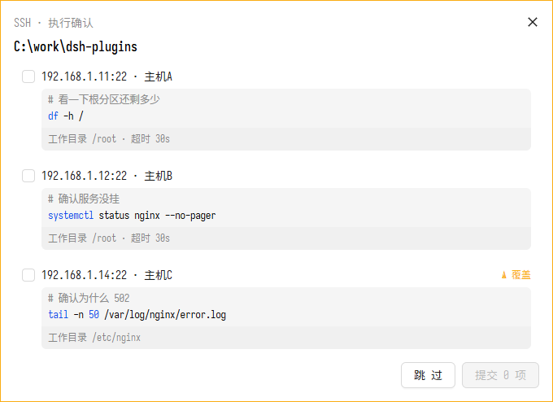

# dsh-ssh-remote

受控的多主机 SSH 执行与搬运插件（DSH 插件，自己实现，不依赖第三方 DSH 插件）。

模型可以操作多台服务器和本机 WSL，但**每条操作都要先经一张多选审批卡**由人逐条勾选；
密码用 Windows DPAPI 加密存在插件数据目录，只在插件进程内存里解密，**不进模型上下文**；
SSH 连接常驻复用，避免每条命令重新握手。

## 装

只走 `plugin_manager`（Web 插件页或 Creator 会话的工具），不要手写 profile：

```text
plugin_manager(action: "install_bundle", target: "C:\work\dsh-plugins\dsh-ssh-remote")
```

装完是 Junction 指回本仓库目录，所以依赖必须装在本目录（`pnpm add <pkg>`），装 profile 无效。
改了 `index.js` / `lib/*.mjs` 后**必须重启 DSH** 才生效（ESM 模块缓存）；改配置文件和 `hosts.json` 不用重启。
`lib/client.js` 是浏览器侧半边（只给**网页端宿主内置的提问卡**注入样式修正；C-10 之后 ssh 的审批不走那条通道，
见下面「卡片长什么样」），改动同样要重启——客户端包清单在启动时扫描
`package.json` 的 `dsh.client`，负结果缓存到重启为止；只改这个文件的内容时宿主会发现 mtime 变化并替换模块。

## 维护接口（插件设置页用）

宿主侧一套 HTTP 接口，浏览器**同源 `fetch`** 直接调；维护逻辑**一份实现在宿主**（`lib/api/`），
设置页是唯一调用方，不写第二套。前缀 `/plugin-data/ssh-remote/api`，全部 POST + JSON（`hosts/list` 也收 GET）。
鉴权走宿主的 `ctx.connection.requestRejection()`：拒绝一律 `403`，不回业务数据。

凭据（`password` / `secret`）只在这一次请求的内存里过一手就进 vault（DPAPI 密文）：**不回显、不进日志、
不进错误文本**；返回里只有 `passwordSaved` / `hasSecret` 这类布尔。接入点不存在、或地址/appid/密钥没配全时，
`gateway/assets` 与 `gateway/import` 回 400。

| 接口 | 入参 | 出参 |
| :-- | :-- | :-- |
| `hosts/list` | 无 | `{hosts:[{id,address,port,user,label,tags,source,connected}], config}` |
| `hosts/save` | `{id?, address, port, user, label?, tags?, password?}` | `{host, created, passwordSaved}` |
| `hosts/remove` | `{id}` | `{removed:true}` |
| `hosts/label` | `{id, label}`（留空退回地址） | `{host}` |
| `hosts/test` | `{id}` | `{ok, ms, error?}`（连不上也是 200） |
| `gateway/list` | 无 | `{gateways:[{id,label,address,appid,port,hasSecret,configured}]}`（**永不返回密钥**） |
| `gateway/save` | `{id?, label, address, appid, port, secret?}`（留空＝不改密钥） | `{gateway, created, passwordSaved}` |
| `gateway/remove` | `{id}` | `{removed:true, id, hostsKept}`（从它导入的主机保留） |
| `gateway/assets` | `{gatewayId}` | `{gatewayId, assets:[{assetId,name,address,account:{alias,username}|null,imported}], skipped}`（**一个账号一行**） |
| `gateway/import` | `{gatewayId, items:[{assetId, account}]}`（`account` 是账号别名） | `{gatewayId, imported:[{id,address,user,account,created}], skipped:[{assetId,account,reason}]}` |

接入点可以有多个，一个接入点一份密钥（vault 键 `jms:<gatewayId>:secret`）。带 `id` 保存＝改那一个，
不带＝新建（id 由地址派生）。删掉接入点后它导入的主机仍然在列表里，只是连不上——
报「来自接入点「…」，但它已经被删除了：请重新导入这台主机，或把接入点加回来」。

错误码：`400` 入参 / `403` 未授权 / `404` 无此接口 / `405` 方法不对 / `500` 宿主内部 / `502` 接入点侧失败，
body 都是 `{error}`。接口事实与取舍见 `DECISIONS.md` D-41。

## 卡片长什么样

审批看的是仓库根 `shared/ui-card` 的 **WebView2 卡**：左列勾选框，右列一行目标（主机，或搬运时的
`源 → 目标`；`⚠ 覆盖` 这类警告在同一行右侧），目标下面一个等宽代码框——框内第一行是 `why` 说明
（注释色、**渲染时加 `# ` 前缀**）、第二行命令、
框底附注条放 `工作目录 / 超时`。选项行承担的是「勾哪台 / 哪一项」，所以它**只写目标**，命令一律在代码框里。

**选项行写什么**（B-22 / B-23，实现在 `lib/hosts.mjs` 的 `targetLabel()` 与 `lib/approval.mjs`）：

- **远程主机一律写 `地址:端口 · 别名`**，例如 `192.168.1.13:22 · project-a 主机D`。
  只写别名时分不清同型号的几台测试机，唯一能定位到机器的是地址；端口**不省略**（22 也写出来），
  因为同一地址上跑两个 sshd 的两台主机省了端口就完全重名——勾错就是执行错机器。
  WSL 是用户点明的例外：本机发行版没有地址端口，保持 `WSL(Debian)`；
- **不把命令首行 / 文件名拼进选项行**。以前拼过「主机 · 命令首行」，长命令被截成
  `… for u in https://download.dock…`，既看不懂又挤掉了主机名；
- **同一目标多条时加 `①②③`**：一条 step 一行，同一台主机跑两条命令（或同一对主机间搬两项）时标签会重名，
  只要有一对撞车，**所有**选项都带编号，变成 `① 192.168.1.11:22 · Web 1` / `② 192.168.1.11:22 · Web 1`，
  正文块标题同步带同一个编号。编号的职责只是让勾选映射回行号，不是装饰；
- **一个标签走所有出口**：`targetLabel()` 同时供勾选行、正文标题、执行结果、错误信息与审计，
  所以结果行读作 `✅ 第 1 条 · 192.168.1.11:22 · Web 1 · 退出码 0 · 120ms`，搬运失败也写成
  `源不存在：192.168.1.11:22 · Web 1:/srv/app.tar`——认机器只看这一段。

只有一行、又没有附加信息时，正文不再顶一行标题（选项行已经写着目标）。`lib/approval.mjs` 仍会拼一段
Markdown 正文（`**目标** · 附加信息` + 围栏代码块），但共享外壳是按 `rows` 逐行渲染的，那段只在没有 `rows`
时（`-DetailFile`）兜底，不是卡上看到的样子。

**搬运卡的行是说明文字，不是命令**（D-37）：`ssh_copy` 每一行的框内是注释色的说明行（`why` 原文、渲染时加 `# ` 前缀）+ 两行
`Source: …` / `Target: …`（路径**不带反引号**），行协议带 `lang: 'text'` 让页面**不做 shell 高亮**；
`ssh_run` 的行仍然不带 `lang` 键（缺省按 `sh` 高亮），命令原文一个字节没改。
行协议因此是 `{ label, why, text, meta, warn, lang? }`，`lang` 只影响 `text` 的渲染。

`lib/client.js` 是**网页端宿主内置提问卡**的样式修正：选择器只用组件写死的字面量锚点
（`[data-question-key]` / `[data-question-scroll]` / `.md-code-block` / `[data-code-block-banner]`），
把文档节奏（块间距 16px、代码块标签条 36px、选项行 40px）压成对话框节奏。C-10 之后 ssh 的审批不经过
宿主提问卡，这段样式因此**不影响 ssh 的卡片**，只作用于网页端宿主自己的提问卡；聊天记录里的普通 Markdown 不受影响。

## 审批只有一张卡（所有会话都一样）

ssh 的审批**没有第二条通道**（C-10）：`ssh_run` 与 `ssh_copy` 弹的都是上面那张 WebView2 卡
（抬头 + 主机/路径标签 + 每行一个带命令的勾选项 + 右下角「跳过 / 提交 N 项」）。根会话、子代理、
网页端发起的调用**一视同仁**——`askApproval()` 只看「有没有卡片构建器」（`dialog` 的 `selectRows`），
不看调用者是谁，也不再问宿主内置的问题弹窗（`userQuestions` 那条 `channel.ask` 分支已删）。

- **卡片报错 → 原样上抛**，命令失败、人重试；不静默切到别的通道：换了通道，人还以为自己批准的是刚才那张卡；
- **卡片构建器缺失**（`dialog` 没有 `selectRows`）→ 抛「没有可用的审批卡片（dialog 的 selectRows 未就绪）…
  请重试」，一行都不执行；
- **没有逐条 allow-once 的旁路**，也没有「先提案、再执行」两步流程：审批与执行在同一次工具调用里闭环；
- 点 ✕ / 按 `Esc` / 点「跳过」＝ 一行都不执行（关窗本身不是同意）；`Enter` 是提交，要过防误点与勾选检查
  （见下面「落在哪里、什么时候能点」）。

代价（如实记）：卡片起不来时整次调用失败，没有浏览器审批可退，重新发一次请求即可。旧版本「子代理被
`DELEGATED_CALLER` 拒绝后才退到桌面卡」的分支已经不存在，读到旧文档里那句请按这一节为准。

## 弹窗长什么样

只有一种窗口：仓库根 `shared/ui-card` 的共享卡片（WebView2 + React/antd 单文件产物）。ssh 的弹窗
**只剩一张卡**——`ssh_run` / `ssh_copy` 的勾选项就是审批（B-47 / DECISIONS D-49），`dialog.ps1 -Mode select`
是唯一模式；共享外壳现在也只有两种卡：勾选卡（`rows`）与审批卡（`body` + 两个按钮，见
[审批卡](../dsh-approval-notifier/README.md)）。

| 模式 | 用在哪 | 差别 |
| :--- | :--- | :--- |
| `select` | `ssh_run` / `ssh_copy` 的审批（`dialog.ps1 -Mode select`），所有会话共用 | 每行一个勾选框 + 目标标签（远程主机是 `地址:端口 · 别名`，覆盖警告在右侧），下面是代码框：原因作首行注释、命令（搬运卡是 `Source:` / `Target:` 两行说明，`lang='text'` 不高亮）、框底 cwd/超时；可回车提交 |

下面这张是**中性示例载荷**（地址 `192.168.1.11/12/14`、备注「主机A/B/C」、工作目录 `C:\work\dsh-plugins`，
不是真机资产）**离屏渲染**出来的，不是真机上弹出来的窗口；图里发灰的按钮是防误点还没解锁
（真机窗口可见 1 秒后即可点）。主机标签就是正式写法 `地址:端口 · 别名`（B-22）。
两张卡片截图（本插件的勾选卡、`dsh-approval-notifier` 的审批卡）已于 2026-11-16 按当前产物统一重出
（`tests\layout.ps1` 第 7 条守「图不比产物旧」；R-08 因此可以销账）；本插件只剩下面这一张。



> **示例载荷 · 勾选卡**：抬头「SSH · 执行确认」（「域 · 动作」两段）；首行是工作目录（路径）。
> 下面 **3 行，一行就是一个执行单位**：左列勾选框 + 右列第一行主机（第三行右侧橙色 `⚠ 覆盖`，
> 因为目标已存在、要覆盖才会执行），主机行下面一个等宽代码框——框内第一行是 `why` 说明（注释色、
> 带 `# ` 前缀）、第二行命令、框底附注条（`工作目录 /root · 超时 30s`，靠深一档的底色
> 与命令区分，框里没有 1px 分隔线）。行与行之间也**没有分隔线**，只靠留白分块。
> 页脚右边「跳过 / 提交 0 项」：一行没勾时「提交」不可点，勾了才变成「提交 N 项」。

**卡片只有一条渲染路径**：仓库根 `shared/ui-card` 的共享外壳（AntdUI 那套自绘卡已整体删除，
插件目录里连 `vendor/` 都没有）。也没有「起不来就换一张」的退路——宿主内置的问题弹窗同样不在候选里
（C-10）；起不来就写 stderr、非零退出，命令失败重试（见下）。

### 卡片（审批）

审批卡结构：抬头「SSH · 执行确认」，**一行就是一个执行单位**——
勾选框 + 目标主机同一行（「覆盖」这类警告在主机右侧），下面是等宽代码框：第一行是 `why` 说明
（注释色、**渲染时加 `# ` 前缀**）、第二行命令（默认换行）、框底附注条放 cwd / 超时（靠深一档底色区分，框内没有分隔线）；行与行之间
也没有分隔线，只靠留白分块；右下角「跳过 / 提交 N 项」、右上角 ✕。
抬头的「域 · 动作」已经说清这张卡要你做什么，首行只放路径，不写固定句子。
**拖动窗口只能按抬头那一行**（`SSH · 执行确认`：卡片抬头 = 载荷 `eyebrow`）——
按住首行的路径是拖不动的，那只是一行文字（2026-11-10 真机反馈过「怎么是工作路径那一行能拖动」）。
点整行任意位置都能切换勾选。

**落在哪里、什么时候能点**（两条都是踩过坑才定下来的）：

- 默认出现在**主屏右下角**，距可用区边缘 16px（按 DPI 缩放，任务栏不算在内）。以前各弹各的
  （一次性对话框居中、通知卡在角落），同一个产品里两种落位只会让人怀疑「是不是又有 bug」；
  角落还不容易正好落在鼠标底下。ssh 的卡片在角落；
- 窗口**真的可见之后 1 秒内按钮点不动**（页面上只有按钮置灰，不额外写倒计时文案）。卡片是突然
  冒出来的，鼠标可能正停在按钮位置上，少了这一秒就容易「手一抖就批了」。计时起点是宿主的
  `shown` 消息（窗口已显示），不是页面加载完成——量尺寸那几百毫秒不能算进来，否则等于少给了反应时间。
  `-ArmMs 0` 只留给自检脚本。

审批卡的键盘是桌面弹窗的既有习惯，但**快捷不等于绕过检查**：

- `Enter` = 主按钮（提交），走的是和鼠标同一个就绪判断：没到 1 秒、或一行都没勾，回车什么也
  不做。不能把「按了回车没反应」变成「按了回车就算同意」；
- `Esc` / 右上角 ✕ / 「跳过」= 一行都不执行，且不算作答（关窗本身不是同意）；
- 「提交 N 项」里的 N 是当前勾选行数（一行没勾就是「提交 0 项」且按钮不可点）——提交必须
  带上是哪几行，否则等于让人在看不到会跑什么的情况下点头。

**渲染源只有一份**，在仓库根 `shared/ui-card/`（结构见 [`docs/shared-ui-card.md`](../docs/shared-ui-card.md)）：

| 文件 | 是什么 | 改法 |
| :--- | :--- | :--- |
| `shared/ui-card/app/src/App.tsx` | 卡片结构、交互（勾选行、按钮、✕、防误点、倒计时、键盘） | 改外观/交互改这里 |
| `shared/ui-card/app/src/main.tsx` | 挂载与 antd token（**字体**、字号、圆角、控件高） | 改字体/视觉基线改这里 |
| `shared/ui-card/app/src/styles.css` | antd 表达不了的三件事：两阶段高度契约、细滚动条、去焦点环 | 只能在这里补 CSS |
| `shared/ui-card/dist/index.html` | 上面三者的构建产物（约 690 KB / 705,961 字节，**入库**） | **不许手改**；`npm run build` 生成 |
| `shared/ui-card/card-html.ps1` | `New-CardPayload` / `New-CardRow` / `New-CardButton` / `New-CardDocument` | 改载荷与拼装改这里 |
| `shared/ui-card/webview2.ps1` | `Show-CardWindow`：建窗口、两阶段量高、收消息 | 改窗口行为改这里 |

**改卡片外观的唯一流程**：改 `app/src` → `cd shared/ui-card/app; npm run build` → 把
`dist/index.html` 一起提交 → 跑 `tests/card-shell.ps1` 与 `tests/shared-ui-guard.ps1`。
不构建就不生效，手改产物会被 `tests/card-shell.ps1` 抓出来。改 `.ps1` 或产物都**不用重启 DSH**
（卡片每次现读）；只有 `index.js` / `lib/*.mjs` 要重启。

插件目录里**不留这些文件的副本**（仓库根 `tests/shared-ui-guard.ps1` 断言）；插件只写业务：

分层（本仓 `AGENTS.md` 第 2 条）：`scripts/ui/shared.ps1` 只做「SSH 载荷 ↔ 外壳输入」
（`New-SshCardPayload`）与「页面消息 ↔ 业务结果」（`ConvertTo-SshDecision`）；
`scripts/ui/card.ps1` 只负责弹一次卡、
把结果换成调用方要的形状（`Invoke-SshCardSelect`）；
`dialog.ps1` 只管参数、文件协议与退出码；建窗口、量高、消息收发都在外壳里。

为什么不再自带一份：两个插件各写一遍时，同一个 bug 要修两遍、修法还不同。外壳用
`Get-SshCardShellDir` 从 `$PSScriptRoot` 逐级上溯找 `shared/ui-card`（不复制、不用 junction）。
代价是**插件不再自包含**：单独把 `dsh-ssh-remote/` 拷出去会找不到外壳（弹窗报错退出，不假装成功）。

和网页端**有意不同**的几处（统一的是语言，不是像素）：

- 没有翻页器（`1 / 1`）：一次只问一张卡，用不上；
- 没有「收起」：窗口本来就按内容自适应高度；
- 首行显示**会话工作区**（`exec.agent.session.header.cwd`，没有会话时退回 `process.cwd()`，见 `lib/approval.mjs`
  的 `resolveWorkDir`），而不是一句通用说明——桌面上冒出来的窗口得让人一眼看出是哪个项目在问；
  取会话工作区而不是宿主进程的 cwd：后者跟着宿主启动目录走（本机是 `%USERPROFILE%`），认不出项目（D-48）；
- 页面在 `measure` 阶段报内容高，宿主钳高后才显示，不会先露一个矮框再蹦高；最高按屏幕
  可用高度算（取屏高 62%，夹在 160–760），只有行数特别多时才在卡片内部滚动，页脚始终钉住；
- 滚动条用 WebView2 原生细滚动条（`app/src/styles.css` 里 8px、半透明墨色、hover 加深），没引悬浮滚动条库；
- 命令**默认折行**（审批要看全命令，不能一开始就藏掉半行），超过 6 行折起，右上角悬停出「复制 / 展开」：
  按钮**恒有**（不再由是否溢出决定，没超出的短命令也能展开）；只有溢出与否决定折叠 / 展开**是否定高**——
  溢出过的框展开后不折行、框内上下左右都能滚、框高与折叠态相同（卡片高度不变），没溢出过的短框
  展开只关掉折行、仍按内容自适应；复制只取命令本体，不含首行说明（说明是代码框首行带 `# ` 的注释）（B-28 / B-29 / B-32）；
- 代码高亮用 **Shiki**（`shellscript` + `powershell`，IDEA Light 调色板：注释灰 `#8C8C8C`、
  字符串绿 `#067D17`、关键字蓝 `#0033B3`，认不出退纯文本；B-10 / B-30）；
- 字体：用户指定**全局**等距更纱黑体 SC（`Sarasa Mono SC`，本机已装）。只在
  `app/src/main.tsx` 的 antd token（`fontFamily` / `fontFamilyCode`）与 `app/src/styles.css` 的
  `body` 栈里各写一次，正文/代码/按钮一起换，回退链是 `Cascadia Mono → Consolas → monospace`；
  中文族名必须排第一（GDI 只认中文名，写英文名会静默回退）；
- 不逐像素对齐：抗锯齿交给 WebView2，形状与间距一致即可（字体按上面那条统一指定，不再走系统默认）；

交互都是真的：整行点击即切换勾选（antd `Checkbox` 的 `checked` 由载荷下标对齐），
按钮右键一律 `type="default"`、主按钮 `type="primary"`，`✕` 只发 `cancel`；
脚本不碰视觉，颜色/间距全走 antd token。

### 卡片起不来时

没有退化卡：外壳缺失、`vendor\webview2\` 三个 DLL 缺一个、机器没有 WebView2 运行时、或起窗口
抛异常，`dialog.ps1` 都会往 stderr 写一条明确的「弹窗起不来：…」，并以 **1** 退出。调用方
（`lib/admin.mjs` 的 `selectRows`）据此抛出，`ssh_run` / `ssh_copy` 报错、人重试即可——**「暂时弹不出来」不是
再维护一套界面的理由**；反过来，绝不能把「没弹出来」当成「用户什么都没选」悄悄放过去。

那三个文件（共约 0.9MB）**不再跟着插件走**，统一放在仓库根 `vendor\webview2\`（外壳按相对路径找，
插件目录里没有副本）：

```
vendor\webview2\Microsoft.Web.WebView2.Core.dll      703 KB
vendor\webview2\Microsoft.Web.WebView2.WinForms.dll   39 KB
vendor\webview2\WebView2Loader.dll                   190 KB
```

机器上仍需要 WebView2 运行时（Win10/11 装了 Edge 就有；外壳的 `Test-CardWebView2` 会读注册表里的 `pv` 报版本）。

### 新增 / 修改主机、改备注、删除（只在插件设置页）

会话侧**没有维护入口**（B-47 / DECISIONS D-49）：`ssh_admin` 只剩只读的 `list`，ssh 的卡片只有
`ssh_run` / `ssh_copy` 的勾选卡。这些事都在**插件设置页「SSH 主机」**（设置左栏的一级页）里做，
走的是上面「维护接口」那套 HTTP 接口（一份实现，设置页是唯一调用方）：

- **新增 / 编辑**：主机表上方一个「新增主机」，一行一台；表单里填地址、端口（默认 `22`）、用户名、密码、
  简称（**新增必须填密码，编辑时留空＝不改密码**；密码框永不预填，保存后页面上不回显）；
- **改备注**：列表里那一栏直接点开改，回车保存、`Esc` 取消；留空退回地址；
- **测试**：每行一个「测试」按钮，只做一次连接并报结果与耗时，不改任何文件；
- **删除**：每行一个「删除」，在页面上二次确认（一句话 + 两个按钮），删掉那一条，
  `vault.dat` 里它的密码一并清掉。

**判重只看 `用户名 + 地址 + 端口`**（`hostIdentity`，与 `addrHash` 同一个口径）：

- 三元组没命中 → 新增：密码必填，写 `vault.dat` 再写 `hosts.json`；
- 三元组命中 → 改那台：密码留空＝不改密码，非空＝覆盖。所以「改密码」就是重填一次同一台主机，
  不再有单独的动作；
- 只差端口（同一地址上另一个 sshd）、只差用户名（同一台机器另一个账号）都是**另一台**，
  各自的密码互不覆盖。

**主机 id 由地址生成**（存 `hosts.json` 的键，也是 `ssh_run` 里 `hosts` 用的名字）：默认就是地址
（`192.168.1.12`），被占了才退到 `地址-端口`、`地址-端口-2`；更新已有主机时 id 不变（vault 以 id 为键，
换 id 等于丢密码）。

### 批量接入（只在设置页「SSH 主机 → 接入点」）

批量导入**不在会话侧**（`ssh_jms` 已随 B-47 删除，DECISIONS D-49）：在设置页的接入点区域，一个接入点一块表单，
各自填名称 / 地址 / `appid` / 接入端口 / 密钥，各自「保存」「拉取资产」「勾选导入」「删除」
（接口清单见上面「维护接口」，取舍见 `DECISIONS.md` D-40 / D-45）：

1. **接入点表单**：地址填 `192.168.1.18` 或 `https://192.168.1.18:8443`（写了端口就是 Web 端口）；
   接入端口是登录通道的端口，**默认 `2222`**。**密钥留空＝不改**：第一次必须填，之后想换密钥再填一次；
   `appid` 与地址/端口存 `config.json` 的 `jms` 块，密钥只进 `vault.dat`
   （条目名 `jms:<gatewayId>:secret`，同样是 DPAPI，页面不回显）。
2. **拉取资产后的表**：这个 appid 能看到的**全部资产**，**一个账号一行**——地址、名称、账号、状态各一列；
   已经导入过的那个账号标「已导入」（重导＝更新那台）；勾哪行导哪行，一行不勾＝什么都不写。
   一台机器两个账号导入后是**两台主机**（身份含用户名），备注默认 `资产名 · 用户名`，列表里分得清。
3. **多个接入点**各一份密钥，互相独立：删掉一个不影响另一个，它导入的主机也保留（只是连不上）。

**导入后的主机和普通主机没有区别**（这是要求，不是实现细节）：`ssh_admin list` 里混排
（密码那列显示「凭据已接入」）、`ssh_run` / `ssh_copy` 用法完全一样、审批卡也是同一张。
`hosts.json` 里这条记录多一段内部标记 `via`（接入点 id + 资产 id + 账号别名 + 账号用户名），它只决定**怎么建连**：

- 连的时候服务器地址用资产 IP、用户名用账号用户名、端口 22（`ssh_run` 里看到的就是这些）；
- 真正连的是接入点（`via.gatewayId` 指出是哪一个）：每次建连现签一个一次性连接凭据，连到它的接入端口——凭据约 5 分钟内有效、
  只用一次，**不缓存、不进连接池的键**（键仍是 `地址|端口|用户名`），所以过期只影响「下一次重连」，
  已经建立的会话照跑；
- **取消导入**就在设置页删掉那台主机：导入主机在 `vault.dat` 里没有密码可删；
- **改备注**就在设置页主机表里改那一栏：导入主机的备注默认是资产名（资产名等于 IP 时它本来就等于地址）；
  **一台资产有多个账号时**备注是 `资产名 · 用户名`，否则两台主机同名，列表里分不清。

边界与已知差异：

- **`hosts.json` 的 `via` 不合法就忽略**（按普通主机连接，并在 `ssh_status` 里记一条 warning）：
  手改过的标记不会被信任成「能连」；
- **输出前缀已经切干净，退出码与 stderr 也补齐了**：接入点每个 exec 通道的 stdout 前面有固定前缀，
  而且**不回 exit-status、不给 stderr 通道**（真机实测 `false` 也报 0、`>&2` 的文本看不到）。两条路径都处理了——
  搬运/预检靠首尾标记切字节流；`ssh_run` 用子 shell 包一层标记、`2>&1` 把 stderr 并进 stdout、
  真实退出码写成 `@@DSH_RC=<n>@@` 由 stdout 带回（读侧取最后一个并从输出里删掉），
  所以命令输出、报错文本与退出码都与普通主机一致。**代价**：导入主机的 `ssh_run` 结果里 `stderr` 字段是空的
  （报错已经并入 stdout，不是丢失）；某条通道没有起始标记时（标记被手改、远端提前掐断）**原样返回**
  而不是报错，宁可多一段前缀也不让普通命令莫名失败；
- 资产清单只取第一页（`?limit=100`）：超过 100 台的账号导不全，这条未在真机验证。
- 账号也是只取一页（每台资产的 `asset_accounts`，与资产清单同一把 `limit`）：单台超过 100 个账号的环境不适用，同样未在真机验证。
- 一个账号一行意味着「一台资产 × N 个账号」在设置页资产表里是 N 行：账号特别多的环境下表会很长，
  资产列表限高 320px 内部滚动、表头吸顶。

### 自检不用盯屏幕

- **卡片**（只剩审批这一张）：`dialog.ps1 -Mode select -RowsFile … -RenderTo .session-files\tmp\out.png`
  走 WebView2 离屏截图（外壳的 `-OnRendered` 回调抓一张再关窗），出来就是卡片最终长相；
  **临时图别落仓库根**（`out\` 已禁止，见 `docs/repo-layout.md` §1）；正式图只进 `docs\images\`。
  `tests/card-select.ps1` 再覆盖外壳定位、结构生成、结果映射与源码契约（不建窗口，秒级）；
  共享外壳的两种卡都能离线看长相：`shared/ui-card/app` 里 `npm run dev` 后开 `?fixture=select` / `?fixture=approval`。
- **批量接入**：`pwsh -NoProfile -File tests\jms.ps1`（45 项，纯 PS + 一小段 node 只读纯函数：
  签名串与已知 HMAC、前缀标记切片的二进制一致性、`ssh_run` 的执行包装与退出码标记解析、
  `hosts.json` 的来源标记与 `targetLabel` 去重、备注接口的入参校验、禁词扫描）。
  它不联网、不碰真 `vault.dat`、不建窗口。
- **已删除：`tests/popup-visibility.ps1`**。它原本守的是「密码框是唯一由 WinForms 直接显示的窗口，
  宿主的 `SW_HIDE` 会顶掉第一次 `ShowWindow`」；现在没有原生窗口了，卡片路径的显示由外壳的
  `Invoke-CardForceShow` 保证，`tests/card-select.ps1` 里有对应源码契约（断言外壳仍调用它），
  不需要再单独起一个窗口去量可见性。

## 兼容性（DSH 版本）

针对 **DSH 0.2.2-rc.3** 实测写成；`package.json` 声明 `engines.dsh: ">=0.2.2-rc.2"`，DSH 版本低于这条
下限时插件会被拒绝激活。升级 DSH 后按下面几处各看一眼，通常五分钟：

| 位置 | 依赖什么 | 失效表现 | 怎么修 |
| :-- | :-- | :-- | :-- |
| `lib/approval.mjs` / `lib/admin.mjs` | `createDialogRunner` 给出的 `dialog.selectRows`（**唯一**审批界面，不再依赖 `userQuestions`）与 `ctx.subprocess.spawn({ argv, stdio, graceMs, signal })` | 审批直接报「没有可用的审批卡片…请重试」，或所有弹窗都起不来 | 核对 `dialog.ps1 -Mode select` 的参数（`-RowsFile` / `-OptionsFile` / `-OutFile`）与退出码（0 = 有答案、2 = 取消） |
| `lib/client.js` | `[data-question-key]`、`[data-question-scroll]`、`.md-code-block`、`[data-code-block-banner]` | 静默退回官方默认样式，功能不受影响（只影响网页端宿主提问卡，ssh 自己的卡片不走这段样式） | 在浏览器里看一眼提问卡结构，换掉失配的选择器 |
| `shared/ui-card/app/src/main.tsx` + `dist/index.html` | antd 版本与产物结构（`#dsh-payload` 标签、`data-phase`） | 卡片白页或样式全丢 | 重新 `npm run build`，把产物一起提交；别手改 `dist` |
| `index.js` | `ctx.tools.register(def)`、`def.output.render` | 启动报错，插件挂不上（一眼看得出） | 按新签名改 |

版本门槛只有 `engines.dsh` 这一条，其余不押会随构建漂移的锚点：不用哈希类名（`Mbwy4a_card` 这类是
`.module.css` 的构建产物，随版本变），上面那些锚点都是组件 JSX 里手写的字面量，DSH 自己的样式表也在用
（`._markdown_1ypvv_5 li>*:last-child:not(.md-code-block)`）。

## 工具

| 工具 | 作用 | 要不要审批 |
| :-- | :-- | :-- |
| `ssh_status` | 主机/发行版清单、连接状态与延迟、密码库状态、配置最后读取时间 | 不用 |
| `ssh_admin` | 只有 `list`（只读列出现有主机与 WSL 发行版）。新增主机、改密码、改备注、删除、接入点导入都在**插件设置页「SSH 主机」**里做，会话侧没有这些动作，也不弹卡（B-47 / DECISIONS D-49） | 不用 |
| `ssh_run` | 命令 × 主机组，一条 step 一行卡片；目标可以是主机 id 或 `wsl:<发行版>` | 每行单独勾选（勾选卡＝审批） |
| `ssh_copy` | 文件/目录在远端与 WSL 之间对流搬运（目录递归），不落本地磁盘 | 每项单独勾选（勾选卡＝审批） |

`ssh_run` 的例子：

```json
{ "steps": [
  { "command": "uname -a", "why": "看内核", "hosts": ["web1", "web2"] },
  { "command": "df -h", "why": "看磁盘余量", "hosts": ["db1"], "cwd": "/tmp" }
] }
```

每条 step 都是一次独立的 shell：`cd` 与 `export` 都只在本条内生效，下一条从头开始。不传 `cwd` 时的起点是登录用户家目录（远端主机）和 `$HOME`（WSL，早期版本起在插件目录翻译出的 `/mnt/...` 下）；要固定目录就传 `cwd`——远端包成 `cd '<cwd>' && 命令`，WSL 用 `wsl.exe --cd`。

`ssh_copy` 的例子：

```json
{ "items": [
  { "from": { "target": "web1", "path": "/srv/dist/app-1.4.0.tgz" },
    "to":   { "target": "wsl:Debian", "path": "/home/me/build/" },
    "why": "把发布包送到本机 WSL 里跑一遍冒烟测试" },
  { "from": { "target": "web1", "path": "/var/log/app" },
    "to":   { "target": "web2", "path": "/var/log/app" },
    "why": "把日志目录复制到备用机（overwrite 会整目录替换，不会合并）",
    "overwrite": true }
] }
```

搬运语义：

- 目标 `path` 结尾带 `/`（或本身已是目录）时，落到该目录下并沿用源的名字；
- **默认不覆盖**：目标已存在就在预检阶段整单失败，并提示把该项 `overwrite` 设为 true；
- 目标端一律先写临时名（`.dsh-copy-*` / `.dsh-ssh-copy-*`）再换到位。
  覆盖目录时**不删旧目录**：先把它改名成同目录下的 `.dsh-ssh-bak-*`（同一文件系统，rename 原子），
  新内容搬到位后才删备份；中途失败就把备份改回原名。覆盖文件则直接用 `mv -f` 的原子替换；
- 单次体积上限 `copyMaxBytes`（默认 2 GiB），超了预检就拒绝；
- 传输中超过 `stepTimeoutMs` 没有字节流动就中止并重建连接（按总时长卡会误杀大文件）。

卡片是**多选**的：勾哪行跑哪行；「提交 N 项」要求至少勾一行，一行都没勾时按钮不可点。
什么都不执行就点「跳过」/ 按 `Esc` / 点 ✕（三种都不算作答）。
关掉卡片**不会执行任何东西**，但也没有"再打开"的入口——想重来就重新发一次请求。
一次最多 8 行（`config.json` 的 `maxCardRows` 可调），超了要分批。

## 数据文件

```text
%USERPROFILE%\.dsh\plugin-data\ssh-remote\
├── hosts.json        # 明文：主机元数据，可以手改
├── vault.dat         # DPAPI 密文：密码
├── vault.dat.bak     # 上一份密文（写坏了还能退回去）
├── config.json       # 明文：超时、上限等，首次运行自动生成
└── logs\audit\
    └── audit-YYYYMMDD.jsonl   # 审计：目标/命令/是否批准/退出码/耗时/字节数 + 阶段
```

审计是**追加写**的 JSONL（D-30）：一次调用先落「进入某阶段」（`event: "enter"`、`phase` 三取一），
跑完再按目标落结果（`event: "result"`）。同一个 `callId` 串起整条时间线——相邻两条的 `ts` 之差
就是上一个阶段停了多久；卡住时，最后那条 `enter` 就是它卡在哪：

| `phase` | 含义 |
| :-- | :-- |
| `approval` | 在等用户点卡片，命令还没开始跑 |
| `connect` | 在等连接/认证落地（搬运那侧是预检：先连两端问类型与大小；全 WSL 的搬运也记这一条，因为预检同样会卡住） |
| `exec` | 在执行命令/传字节（纯 WSL 的 `ssh_run` 没有 `connect` 阶段） |

`hosts.json`：

```json
{
  "hosts": {
    "web1": { "address": "192.168.1.11", "port": 22, "user": "deploy", "label": "生产 Web", "tags": ["prod"] }
  },
  "wsl": { "Debian": { "label": "本机 Debian" } },
  "defaults": { "connectTimeoutMs": 15000, "stepTimeoutMs": 30000, "idleTimeoutMs": 600000, "maxConnections": 10 }
}
```

主机 id 是大小写敏感的；`config.json` 的优先级高于 `hosts.json` 的 `defaults`。
三个文件都由 `fs.watch` 热加载，改完存盘即生效（合并 250ms 内的多次改动）。

`config.json` 里与批量接入有关的一块（首次在设置页保存接入点时写入；`appid` 与地址可以手改）：

```json
{ "jms": { "gateways": [ { "id": "default", "label": "默认", "address": "https://192.168.1.18", "appid": "ak-xxxx", "port": 2222 } ] } }
```

密钥不在这个文件里——每个接入点一条 `vault.dat` 条目 `jms:<gatewayId>:secret`，DPAPI 加密（旧版本的单条 
`jms:secret` 在下一次写入时自动挪到 `jms:default:secret`）；`ssh_status` 只报密码库能不能用、条目数多少，
不打印任何密钥。

## CLI（不开 DSH 也能管）

```powershell
pwsh -File scripts\sshctl.ps1 status
pwsh -File scripts\sshctl.ps1 list
pwsh -File scripts\sshctl.ps1 add web1 192.168.1.11 22 deploy 主机E
pwsh -File scripts\sshctl.ps1 set web1            # 交互输入密码（掩码）
pwsh -File scripts\sshctl.ps1 remove web1         # 需输入 yes
pwsh -File scripts\sshctl.ps1 export              # 需输入 EXPORT，明文打到 stdout
pwsh -File scripts\sshctl.ps1 import backup.json
```

`-DataDir <路径>` 可以指定别处（例如备份、迁移演练）。
`SSHCTL_PASSWORD` / `SSHCTL_CONFIRM` 是给自动化测试用的旁路，正常使用不要设置。

## WSL

目标是 `wsl:<发行版>` 时，命令一律走 `wsl.exe -d <发行版> -- sh -c <命令>`（`WSL_UTF8=1`），
不依赖 `\\wsl$` / `\\wsl.localhost`（本机实测不可见）。WSL 侧不需要密码。

## 搬运是怎么实现的（以及为什么不走 SFTP）

`ssh_copy` 把两端都当成「会跑 POSIX sh 的端点」：

| 方向 | 源端 | 目标端 |
| :-- | :-- | :-- |
| 文件 | `cat <路径>` 的 stdout | `cat > <临时名>` 的 stdin，收完再 `mv` |
| 目录 | `tar -cf - -C <父目录> -- <名字>` | `tar -xf - -C <临时目录>`，解完再 `mv` |

四种组合（远端↔远端、远端↔WSL、WSL↔WSL、同机两路径）共用这一条中继，
字节只在两条流之间走，**不落本地磁盘**，也不依赖服务器的 `sftp-server`（很多机器默认关掉它）。

代价是要有 `sh` + `tar` + `cat`——任何 Linux/macOS 服务器都满足，换来的是语义只有一套。
同一台远端主机上的「源」与「目标」必须在**一次**通道申请里取齐，否则会被连接池的按主机串行队列堵死
（这条有单测守着）。

## 安全边界（别把它当隔离环境）

能保证：

- 密码不出现在模型上下文、工具参数、工具结果、审批卡、日志、审计里；
- 密码只以 DPAPI 密文（CurrentUser + 固定熵）落盘，换用户/换机器解不开；
- 不经过 `ssh_run` / `ssh_copy` 就拿不到池子里的连接；
- 每条**用户命令**都必须在卡片里被勾选才会执行（例外是两类只读动作，见下）；
- 主机地址/端口/用户名改过之后，旧密码会被拒绝复用（`addrHash` 不匹配），防止把密码发到另一台机器；
- 同一个 id 改了地址/端口/用户名时，池里的旧连接会被作废，不会出现"卡上写新地址、命令跑在旧机器上"。

两类在审批**之前**就会发生的只读动作（有意为之，不用改）：

- `ssh_run` 的**预连接**：用你读卡的时间盖住握手延迟（有些机器登录要好几秒，等勾完再连会明显变迟钝）；
- `ssh_copy` 的**预检**：每个源/目标各跑一次固定的 `find|wc` 探针，只用来算体积和判断「目标已存在」，
  输出不回给模型、也不改变任何东西。卡上的体积和覆盖警告就来自它。

关掉卡片＝这次不执行（不勾任何行）。想重来就重新发一次请求：卡被收起后没有重新打开的入口。

**不能**保证（用户明确接受的取舍）：

- 模型如果主动用 bash/pwsh 工具去读内存、凭据库或磁盘上别的密钥，本插件挡不住；
- 服务器端的 `sudo`、交互式命令、需要 TTY 的程序不支持（`ssh_run` 只跑非交互命令）；
- `~/.ssh` 里本来就有能直连的密钥时，模型可以绕过本插件；
- 密码认证失败后有 60 秒冷却（防锁号），但这不构成账号保护。

## 打包（生产树不带 `node_modules`）

生产树里**不放 `node_modules`，也不放 `index.js` 源码**，只放一份打包产物 `index.bundle.js`：
`ssh2` 及其依赖（`asn1` / `bcrypt-pbkdf` / `tweetnacl` / `safer-buffer`）已经全部内联进去。
起因是 2026-10-30 那次事故：生产树是真实拷贝，`ssh2` 的依赖没搬全，重启后插件直接
`Cannot find module 'asn1'`，整个插件加载失败。

### 构建

```powershell
cd <仓库或工作树>\dsh-ssh-remote
pnpm install     # esbuild 是 devDependency；只在测试树/工作树装，不在生产树装
pnpm build       # → index.bundle.js（插件根目录）
```

`package.json` 里的 `build` 脚本就是这一条：

```text
esbuild index.js --bundle --platform=node --format=esm --target=node20
        --outfile=index.bundle.js
        --external:cpu-features --external:nan
        --banner:js="import { createRequire } from 'node:module'; …"
```

三个参数都不能少：

| 参数 | 为什么 |
| :-- | :-- |
| `--platform=node --format=esm` | 宿主按 ESM `import()` 装载插件，产物必须是 ESM |
| `--external:cpu-features` / `--external:nan` | `ssh2` 的可选原生加速（AES-GCM）。不打包，运行时 `require` 不到就走纯 JS 回退——生产树没有 `node_modules`，这正是要的 |
| `--banner:js=…` | `ssh2` 是 CJS，塞进 ESM 产物后里面还留着 `require(...)` / `__dirname` / `__filename`。ESM 里这三个都没有，靠 banner 用 `createRequire(import.meta.url)` 与 `import.meta.url` 补上。**删掉 banner 立刻炸**：先是 `Dynamic require of "net" is not supported`，补上 `require` 之后又变成 `ReferenceError: __dirname is not defined in ES module scope`（`ssh2` 内联的 poly1305 胶水里用了 `__dirname`） |

体积：**约 886 KB（906,400 字节）**（2026-11-11 重打；esbuild 0.28.2 / ssh2 1.17.0，`lib\pool`、`lib\copy` 拆分、`lib\jms` 接入层与执行包装改动之后。产物不保证字节复现，大小每次构建会变）。
升级 `ssh2` 或改 `lib/**`、`index.js` 之后**必须重新 `pnpm build` 并提交产物**，否则生产跑的还是旧代码：

```powershell
pnpm build
git diff --exit-code -- index.bundle.js   # 有差异说明忘了提交产物
```

### 产物必须留在插件根目录，不能进 `dist/`

`index.js` 里所有脚本路径都是 `dirname(fileURLToPath(import.meta.url))` 拼出来的
（`scripts\sshctl.ps1`、`scripts\dialog.ps1`、`scripts\protect.ps1` / `unprotect.ps1`）。
`--bundle` 保留 `import.meta.url` 的原义，所以**产物躺在哪，它就把 `scripts\` 认在哪**：挪进 `dist/`
之后 `SCRIPT_DIR` 会变成 `dist\scripts`，那些路径全错。实测（`apply()` + 假 `subprocess` 截 `argv`）：

| 产物位置 | 第一次 DPAPI 调用拿到的脚本路径 |
| :-- | :-- |
| `<插件根>\index.bundle.js` | `<插件根>\scripts\unprotect.ps1` ✅ |
| `<插件根>\dist\index.bundle.js` | `<插件根>\dist\scripts\unprotect.ps1` ❌ 没有这个文件 |

### 验证（改完或升级 ssh2 后跑一遍）

```powershell
cd dsh-ssh-remote
node -e "import('./index.bundle.js').then(m => console.log(Object.keys(m)))"
# → [ 'apply', 'inject', 'optionalService', 'renderHostsSection', 'resolveDataDir' ]

# 纯净目录：只有产物 + scripts\ + lib\ + cordis.patch.yml + package.json，没有 node_modules
$clean = Join-Path $env:TEMP 'ssh-bundle-clean'
Remove-Item $clean -Recurse -Force -ErrorAction SilentlyContinue
New-Item -ItemType Directory $clean | Out-Null
Copy-Item index.bundle.js, scripts, lib, cordis.patch.yml, package.json $clean -Recurse
Push-Location $clean; node -e "import('./index.bundle.js').then(m => console.log(Object.keys(m)))"; Pop-Location
```

`lib/client.js` 是浏览器侧半边（只往 `<head>` 注入样式），**不含 `ssh2`**，所以不用、也不该打第二个包：
生产树照原样放 `lib\`，`exports["./client"]` 继续指 `./lib/client.js`。

### 给 `tools/deploy.ps1` 的交接

生产树的 `dsh-ssh-remote\` 里**只该有这些**：

```text
dsh-ssh-remote\
├── index.bundle.js      ← 唯一入口（main 指它），pnpm build 生成、入库
├── package.json         ← 部署脚本改写 main / exports["."]（见下表）
├── cordis.patch.yml
├── scripts\             ← dialog.ps1 / sshctl.ps1 / protect.ps1 / unprotect.ps1 / ui\
└── lib\                 ← 只有 client.js 是运行时需要的；其余已被打进产物，留着无害
```

- **不放 `index.js`**：源码入口在生产树里没有意义，留着还会让人以为 `main` 指它；
- **不放 `node_modules`**：依赖已内联（部署脚本原本就排除它，这条不用改）；
- `package.json` 在**拷贝完成后**改写这两个字段（其余原样保留）：

| 字段 | 仓库里的值（开发用） | 生产树里改成 |
| :-- | :-- | :-- |
| `main` | `"index.js"` | `"./index.bundle.js"` |
| `exports["."]` | `"./index.js"` | `"./index.bundle.js"` |
| `exports["./client"]` | `"./lib/client.js"` | 不变 |
| `exports["./cordis.patch.yml"]`、`exports["./package.json"]` | 原样 | 不变 |
| `files`、`scripts`、`devDependencies` | 原样 | 原样（不装依赖就不会用到） |

改完这两行，宿主按 `exports["."]` 解析到 `index.bundle.js`；它算出的 `import.meta.url` 是
`production\dsh-ssh-remote\index.bundle.js`，`dirname` 得到 `production\dsh-ssh-remote\`，
`scripts\` 正好在旁边——**这就是产物必须放在插件根目录的原因**。

顺带要动的三处（`tools/deploy.ps1`）：

1. 排除 `dsh-ssh-remote\index.js`（**不能**全局排除 `index.js`：`dsh-approval-notifier` 没有依赖、仍靠源码入口）；
2. `Assert-DeployItemsComplete` 里对 `dsh-ssh-remote` 要求 `index.bundle.js`，不再要求 `index.js`；
3. `Write-DependencyHints` 对 `dsh-ssh-remote` 失效（它不再需要 `node_modules`），可改成断言生产树里
   **没有** `dsh-ssh-remote\node_modules`。

## 开发

```powershell
cd C:\work\dsh-plugins\dsh-ssh-remote
node --test --test-isolation=none "tests/*.test.mjs"   # 10 个文件、33 项，不需要 DSH、不需要真服务器
```

> `package.json` 的 `test` 脚本就是这一条（2026-11-02 已补齐 `dialog` 与 `audit`），`pnpm test` 与它等价。

### 测试环境（改代码前先看这里）

**仓库根是测试树，不是线上**：部署（当前 v0.39）之后，profile 里四个插件都 `link:` 到生产树
`%LOCALAPPDATA%\dsh-plugins\production\`（核对方法见 `docs\deploy.md` §7）。所以在**这里**改代码、改
`scripts/dialog.ps1` 都不影响线上；上线只有一条路：提交 → 打 tag → `tools\deploy.ps1 -Tag <tag>` → 重启。
改代码仍建议走工作树，避免和别的会话互相踩：

```powershell
cd C:\work\dsh-plugins
git worktree add .agents\worktrees\ssh-remote -b test/<改动名>   # 独立分支 + 独立目录，/.agents/ 已被忽略
pwsh -NoProfile -File .agents\worktrees\ssh-remote\dsh-ssh-remote\scripts\dialog.ps1 `
     -Mode select -RowsFile ... -OptionsFile ... -RenderTo .session-files\tmp\after.png
```

- **代码隔离**：只改 `.agents\worktrees\ssh-remote\` 里的文件，仓库根不动；验收通过后把分支合回 `master`，
  **24 小时内** `git worktree remove .agents\worktrees\ssh-remote`（残留会被 `tests\layout.ps1` 第 9 条点名）。
- **数据隔离**：离屏渲染（`-RenderTo`）与单测都不碰真实数据（单测用临时目录 + 假 DPAPI）。要真连机器验证时把工作树单独装进另一个 profile，**不要**把正式的 `link:` 指过去。
- **弹窗改动**：改前/改后各渲一张图对比；临时图落 `.session-files\tmp\`，正式图进 `docs\images\`；像素差异要能解释（字形抗锯齿本身不确定，同一份代码连跑两次也会差几千像素）。
- **部署**：合并后按 `docs\deploy.md` 打 tag 部署；宿主侧 `lib/*.mjs` 与 `index.bundle.js` 都要重启才换代际，`scripts/*.ps1` 现读。

单测用假 ssh2 客户端与假 DPAPI，覆盖：hosts 校验、vault 的 fail closed 与地址绑定、
admin 的 `list` 与「结果里不含密码」（动作只剩 `list`，旧动作一律拒绝且不写盘）、设置页维护接口
（主机 / 接入点 / 资产 / 导入）、连接池的串行/冷却/超时/淘汰/忙闲、审批卡的行数与结构、未勾选不执行、
输出截断、审计不含正文但带阶段时间线、搬运的路径解析与 shell 脚本拼装、
覆盖守卫、体积上限、二进制字节原样到达。

## 状态

已实现：数据层（热加载）、会话侧 `ssh_admin`（只读 `list`）与 `ssh_status`、设置页「SSH 主机」的主机与接入点
维护（新增 / 改密码 / 改备注 / 删除 / 资产导入）、连接池、`ssh_run`（远程 + WSL）、
`ssh_copy`（远端↔远端 / 远端↔WSL / WSL↔WSL）、审计、提示词段落、CLI。
未实现、也不打算实现：`ssh_sync`。搬运用途是「复制」，不是「同步」——不做增量比较、不删除目标端多余文件；要镜像一棵目录树请在目标端自己处理。


